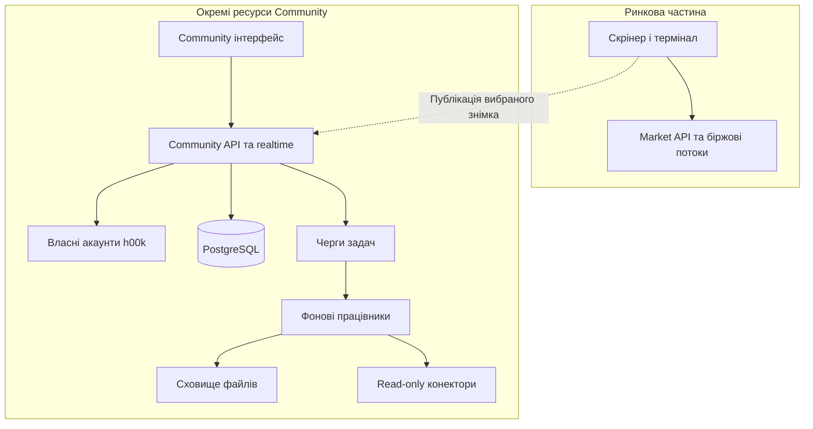

# h00k Community — єдина продуктова й технічна специфікація

**Версія:** 0.6, цільова концепція та стан реалізації для рев’ю.
**Дата:** 10 листопада 2026 року.
**Продукт:** міжнародна соціальна мережа трейдерів у межах h00k.top.
**Репозиторій:** https://github.com/maks37614/h00k.
**Стан роботи:** підготовлено першу реалізацію в окремій гілці. Розділи 1–31 описують цільовий продукт; вони не є переліком уже готових функцій. Фактичний обсяг цієї гілки та решта робіт — у розділі 32 і [community-architecture.md](community-architecture.md). Production-міграції та розгортання не виконано.

## 0. Як читати документ і наскільки відновлена історія

Документ об’єднує первинне завдання, уточнення користувача від 10 листопада про прозорість, власну реєстрацію, стратегії, навчання та безпеку, доступний підсумок розмови «Розвиток комʼюніті h00k» від 9 листопада та переглянуті частини репозиторію. Повний текст попередньої розмови отримати не вдалося. Тому це повна специфікація за доступними матеріалами, але не гарантія відновлення кожної деталі всіх попередніх повідомлень.

Позначення джерел рішень:

| Позначення | Значення |
| --- | --- |
| **В** | Пряма вимога з поточного запиту або доступного попереднього повідомлення користувача. |
| **К** | Факт, підтверджений переглянутим кодом чи документацією репозиторію. Не означає, що функція перевірена на production. |
| **П** | Нова пропозиція для узгодження. Не видається за попередню домовленість. |
| **?** | Питання, на яке ще потрібне рішення. |

Усі докладні правила, числові ліміти, пріоритети й етапи нижче мають статус **П**, якщо вони прямо не внесені до реєстру вимог **В**. Вони утворюють узгоджену робочу модель, яку можна змінити під час обговорення.

### 0.1. Реєстр відновлених прямих вимог

| ID | Вимога | Походження |
| --- | --- | --- |
| В-01 | Міжнародне h00k Community для наявного h00k.top і maks37614/h00k. | Поточний запит. |
| В-02 | Профілі, приватність, торгові сесії, часові зони, статуси та стіни. | Поточний запит. |
| В-03 | Пости, коментарі, репости, Telegram, друзі, приватні чати й групи. | Поточний запит. |
| В-04 | HookChart із формаціями та інструментами малювання. | Поточний запит. |
| В-05 | API бірж у режимі читання, торговий журнал, підтверджені результати. | Поточний запит. |
| В-06 | Рейтинги, бали та нагороди. | Поточний запит. |
| В-07 | PostgreSQL і незалежна від скрінера архітектура без погіршення швидкості графіків та біржових потоків. | Поточний запит. |
| В-08 | Спочатку систематизувати концепцію, відкриті питання та план; код поки не змінювати. | Початковий етап; наступним повідомленням користувач доручив реалізацію. |
| В-09 | До власного статусу можна додавати текст. | Доступний підсумок попередньої розмови. |
| В-10 | У коментарях можна додавати формацію зі списку обраних та фотографію. | Доступний підсумок попередньої розмови. |
| В-11 | Для контенту, зокрема обговорень під постом, потрібна можливість поділитися в Telegram. | Доступний підсумок попередньої розмови; точна поведінка репосту коментаря потребує узгодження. |
| В-12 | Смайли потрібні в постах, коментарях і приватному листуванні. | Доступний підсумок попередньої розмови. |
| В-13 | У налаштуваннях можна вказати власний Telegram-канал і визначити, чи його бачать усі. | Доступний підсумок попередньої розмови. |
| В-14 | Користувачі можуть створювати групові переписки. | Доступний підсумок попередньої розмови. |
| В-15 | Публічно пояснювати антишахрайську мету, походження біржових даних і захист від ручного редагування підтверджених фактів. Абсолютні обіцянки потребують коректного уточнення. | Уточнення користувача. |
| В-16 | Окрема стрічка з вибором користувача: пости друзів або публічні пости. | Уточнення користувача. |
| В-17 | Власна реєстрація h00k; Firebase скасовано в цільовій архітектурі сайту. | Уточнення користувача; замінює пропозицію v0.1 зберегти Firebase Auth. |
| В-18 | У налаштуваннях API потрібні інструкції для бірж і пояснення виключно читального призначення ключів. | Уточнення користувача. |
| В-19 | Конструктор власних стратегій, додавання готових, задачі та аудиторії: усі / друзі / лише я. | Уточнення користувача. |
| В-20 | Планування робочого дня, дисципліна й корисне навчання для початківців. | Уточнення користувача. |
| В-21 | Особисті ліміти збитку за годину, день і місяць зі сповіщенням при досягненні порогу. | Уточнення користувача. |
| В-22 | Інтереси, спосіб життя та добровільний контекст звичок і дисципліни у профілі. | Уточнення користувача. |
| В-23 | Окрема сторінка всіх власних угод: статистика, win rate, входи/виходи, нотатки й причини відкриття; доступ для інших за приватністю. | Уточнення користувача. |
| В-24 | Зрозуміла модель захисту ключів і даних; сервіс не повинен мати торгових, переказних або withdrawal-повноважень. | Уточнення користувача; фактичні технічні межі пояснено в розділах 23–24. |
| В-25 | Захист від виманювання грошей і інформації, пошуку заможних людей, реклами, спаму, образ і переслідування. | Уточнення користувача. |
| В-26 | Відповідь власною версією розмітки графіка в пості, коментарі, приватному або груповому чаті без зміни оригіналу. | Уточнення користувача. |
| В-27 | Особисте й спільне тестування стратегій, обмін результатами, уроками та знаннями. | Уточнення користувача. |

У підсумку також зберігся фрагмент зауваження про підпис під профілем зі словом «переважно». Бажане остаточне формулювання відсутнє. Назву поля й текст підпису потрібно підтвердити окремо; нижче запропоновано поле «Переважно торгую» як робочий варіант.

### 0.2. Рішення, зафіксовані уточненням користувача

Власна реєстрація замінює попередню пропозицію залишити Firebase. Вибір стрічки «Друзі / Публічні», стратегії з приватністю, план дня, ліміти збитків, сторінка угод, альтернативні розмітки та спільне навчання — частина потрібного продукту. Їхній пріоритет у релізах ще обговорюється.

Слова «неможливо підробити» конкретизуються як заборона ручної зміни підтверджених біржових фактів, перевірка походження та видимі межі покриття. Слова «навіть ми не можемо робити дії» конкретизуються як відсутність у прийнятих ключів прав торгівлі, переказу й виведення; автоматичне читання необхідне для роботи сервісу. Абсолютної невразливості або повної недоступності даних будь-якому оператору звичайна серверна архітектура не гарантує.

## 1. Призначення продукту

h00k Community має поєднати доказову торгову історію, безпечне спілкування, стратегії, планування дня та навчання. Основний робочий цикл:

1. Вибрати власну або скопійовану дозволену стратегію і її конкретну версію.
2. Запланувати день, сесію, задачі, перерви та особисті ліміти ризику.
3. Знайти ситуацію у скрінері або на HookChart, перевірити чекліст.
4. За бажанням поділитися розбором і отримати альтернативну розмітку від інших.
5. Після самостійних дій на біржі отримати фактичні виконання через API читання.
6. Переглянути угоду, написати причину входу й розбір виконання плану.
7. Оцінити повноту даних, торгові показники та власну дисципліну окремо.
8. Перевірити нову гіпотезу в Replay, історичному або forward-тесті, не змішуючи це з реальною торгівлею.

Користувач може навчатися й спілкуватися без біржового ключа. Офіційна статистика реальної торгівлі формується тільки з придатних біржових даних. Ручні записи залишаються нотатками або заявленими/навчальними даними. Публічна демонстрація балансу, угод і статистики добровільна. Псевдонім достатній для соціального профілю.

### 1.1. Ролі

| Роль | Можливості |
| --- | --- |
| Відвідувач | Перегляд дозволених публічних профілів, постів і формацій. Доступність без входу — питання для узгодження. |
| Учасник | Профіль, статус, пости, коментарі, друзі, чати, власний журнал. |
| Учасник із підключеною біржею | Імпорт даних і підтвердження в межах фактично доступної історії. |
| Власник або адміністратор групи | Керує складом і правилами конкретного чату. |
| Модератор | Розглядає скарги й застосовує правила спільноти в межах наданих повноважень. |
| Оператор системи | Керує сервісами. Доступ до приватних даних обмежений, обґрунтований і журналюється. |

## 2. Наявна основа h00k: що врахувати під час майбутньої інтеграції

Огляд виконано для `main`, commit `712bf1d827746a3899b77f285b5a2389edc57a10`. Це вибірковий огляд вихідних файлів, не повний аудит і не перевірка фактичного розгортання h00k.top.

| Наявний компонент — К | Наслідок для концепції |
| --- | --- |
| React, TypeScript, Vite та Express. | Community можна розробляти сумісним стеком; окремий репозиторій не є обов’язковою умовою ізоляції. |
| Firebase Auth і профілі/частина особистих даних у Firestore у переглянутому коді. | Це історичний стан коду. За новою вимогою цільовий сайт має власну реєстрацію та PostgreSQL і працює без Firebase Auth/Firestore. Потрібна окрема міграція. |
| HookChart уже завантажується окремим lazy bundle. | Соціальна стрічка має зберегти відкладене завантаження графіків. |
| Є власні малюнки, налаштування, архів формацій та watchlist. | Потрібні адаптери й публікація обраного елемента, без автоматичного розкриття всього особистого сховища. |
| У HookChart є рівні, трендова лінія, прямокутник, Фібоначчі, профіль обсягу, текст, вимірювання, сигнальний рівень. | Базові інструменти варто повторно використати після перевірки сумісності форматів. |
| Є вибір часової зони та обчислення регіональних сесій. | Спільна модель часу потрібна для Community, журналу й графіків. |
| Є Telegram-прив’язка та доставка сповіщень. | Публічний канал профілю й соціальні повідомлення потрібно відокремити від чинних торгових сповіщень. |
| Є кеші, спільні біржові потоки й серверний REST-бюджет. Поточний бюджет локальний для процесу. | Новий процес на тому самому вихідному IP не може покладатися лише на власний незалежний лічильник. |
| Є Replay і симуляційні компоненти. | Їхні дані повинні мати окреме походження й не потрапляти до рейтингу реальних результатів. |
| Є українська, англійська, польська та російська локалізації. | Мови першого релізу потрібно підтвердити, не втрачати наявну інфраструктуру перекладів. |

**Цільовий напрям — В:** власні акаунти h00k для всього сайту, PostgreSQL для належних до сайту персональних і доменних даних; Firebase Auth і Firestore вилучаються з робочої архітектури після перевіреного перенесення. Профілі, архів, watchlist, налаштування графіків і зв’язки не мають загубитися. Код зараз не змінюється. Міграція потребує доведення власності старого акаунта; однаковий введений email сам по собі не є підставою привласнити його дані.

Термін «обране» поки неоднозначний: у продукті вже розрізняються список інструментів і архів формацій. У публікації користувач має обирати саме збережену формацію; остаточну назву та навігацію уточнити.

## 3. Профіль трейдера

### 3.1. Склад профілю

| Блок | Поля й поведінка |
| --- | --- |
| Ідентичність | Стабільний внутрішній ID, унікальний `@username`, відображуване ім’я, аватар, обкладинка, дата приєднання. Зміна username не змінює власника контенту. |
| Про себе | Опис, мови спілкування, необов’язкові країна/місто та посилання. Геолокація не виводиться з IP у публічний профіль автоматично. |
| Інтереси й спосіб життя — В | Інтереси поза трейдингом, звички, спорт, навчання, загальний підхід до відпочинку й робочого ритму. Добровільні поля з окремою аудиторією. |
| Дисципліна — В/П | Самоопис і добровільні звіти про зафіксований план: виконання чеклістів, дотримання обраних лімітів, перерви. Джерело і знаменник показника видимі; це не діагноз психологічного стану. |
| Торгові інтереси | Ринки, біржі, інструменти, стилі, таймфрейми, типи формацій. Досвід зазначається як самостійно заповнена інформація. |
| Час | Часова зона, вибрані торгові сесії, необов’язковий звичний розклад. Видимість місцевого часу та розкладу налаштовується. |
| Статус | Поточна активність, власний текст та емодзі; окремо від технічного online/offline. |
| Соціальні зв’язки | Друзі; кількість і список видимі відповідно до налаштувань. Односторонні підписки — окреме відкрите питання. |
| Telegram | Канал і, якщо потрібно, окремий контакт. Для кожного — незалежна видимість. |
| Торговий результат | Добровільно оприлюднені показники з періодом, охопленням і типом підтвердження. |
| Репутація | Бали внеску, досягнення, роль у спільноті. Не підмінюють статистику торгівлі. |

Робочий варіант короткого підпису: «Переважно торгую: скальпінг · криптоф’ючерси · Лондон / Нью-Йорк». Значення формуються з добровільно заповнених полів. Остаточний підпис не вважається погодженим.

### 3.2. Навігація профілю

Запропоновані вкладки: **Стіна**, **Угоди та статистика**, **Стратегії**, **Розбори**, **Матеріали**, **Нагороди**, **Про трейдера**. Окрема сторінка «Угоди та статистика» обов’язкова: власник бачить усю свою доступну історію; інший читач — лише дозволені налаштуваннями рядки й поля. Особисті плани, щоденник самопочуття, ключі та графікові налаштування початково приватні. Наявність публічного агрегату не відкриває подробиці угод автоматично.

При перегляді чужого профілю доступні доречні дії: додати до друзів, написати, поділитися відкритим профілем, поскаржитися, заблокувати. Заборонені діями приватності кнопки не повинні обходитися прямим API-запитом.

## 4. Приватність і правила доступу

### 4.1. Модель аудиторій

Базові аудиторії: **усі**, **учасники після входу**, **друзі**, **лише я**. Для чатів і приватних груп аудиторія визначається членством. Списки окремо вибраних людей можна додати пізніше, якщо вони потрібні вже на старті — уточнити.

Профіль може бути відкритим або закритим. Закритий профіль встановлює верхню межу доступу для його матеріалів. Якщо автор хоче зробити конкретний матеріал загальнодоступним, інтерфейс має явно узгодити це з режимом профілю й показати майбутню аудиторію до публікації.

**Правило доступу:** користувач одночасно має пройти перевірку видимості профілю, самого об’єкта, його батьківського об’єкта або чату та обмежень блокування. Коментар чи вкладення не можуть отримати ширшу аудиторію за пост. Репост не надає доступу до закритого оригіналу.

### 4.2. Запропоновані початкові налаштування

| Дані або дія | Початково — П | Що може змінити власник |
| --- | --- | --- |
| Псевдонім, аватар, короткий опис | Публічні в разі відкритого профілю. | Закрити профіль, змінити опис. |
| Країна, місто, місцевий час | Приховані до явного вибору. | Відкрити потрібній аудиторії. |
| Telegram-канал | Прихований, доки не ввімкнено показ. | Усі / учасники / друзі / лише я. |
| Email, біржовий UID, приватні реквізити | Приватні. | Не включати до звичайного публічного профілю. |
| API-ключі та секрети | Доступ лише спеціалізованого сервісу. | Замінити або від’єднати; секрет не показується повторно. |
| Баланс, угоди, журнал | Лише я. | Окремо публікувати записи або обрані агрегати; суми й обсяги можна приховати. |
| Відкриті позиції й точний поточний результат | Лише я. | Відкривати явно; запропонований публічний режим — закриті угоди або відкладений показ. |
| Стратегії, чеклісти й тестові проєкти | Лише я при створенні. | Усі / друзі / лише я; для спільного тесту — визначені учасники. |
| План дня, настрій і самопочуття | Лише я. | Поділитися обраним звітом; не публікувати точний побутовий розклад автоматично. |
| Ліміти збитку й повідомлення про них | Лише я. | Добровільно відкрити окремому партнеру дисципліни без права змінювати їх. |
| Інтереси та спосіб життя | Показ після явного ввімкнення. | Окремий вибір аудиторії для різних полів. |
| Присутність, last seen, прочитання | Лише я або друзі, остаточно узгодити. | Приховати або дозволити вибраній аудиторії. |
| Новий пост | Поточна вибрана аудиторія з явним індикатором перед надсиланням. | Вибрати іншу для конкретного поста. |
| Чужі записи на своїй стіні | Вимкнені. | Дозволити друзям із попереднім схваленням. |
| Вхідні повідомлення від незнайомих | У запити на листування. | Друзі / запити від усіх / ніхто. |
| Додавання до груп | Через запрошення. | Дозволити друзям або обмежити. |

Зміна аудиторії на вужчу має впливати на стрічку, пошук, репости, прев’ю, повідомлення про подію, кеші та доступ до файлів. Старе сповіщення може містити лише нейтральне повідомлення про недоступний матеріал.

### 4.3. Блокування й кешування

Блокування припиняє прямі запити дружби, повідомлення, згадки й персональні сповіщення між користувачами. У спільній групі потрібне окреме правило: приховувати контент заблокованого локально й залишити модератору можливість розглядати скаргу. Блокування не можна обіцяти як спосіб приховати загальнодоступний матеріал від людини, що відкриє його без входу.

Приватні відповіді та файли не потрапляють у загальний CDN-кеш. Пошук, лічильники й live-події також проходять перевірку аудиторії. Для приватних файлів — короткочасні посилання або проксі з перевіркою доступу; залишковий строк дії вже виданого посилання потрібно врахувати в моделі відкликання.

Перед публікацією знімка графіка показувати, чи містить він позицію, розмір угоди, фінансові суми та інші приватні позначки. Публікація формації не відкриває інші папки обраного.

## 5. Міжнародність, торгові сесії та часові зони

### 5.1. Загальна модель часу

Події зберігаються як абсолютні моменти часу UTC, у PostgreSQL — `timestamptz`. Назва часової зони IANA зберігається окремо в налаштуваннях: наприклад, `Europe/Warsaw`, `Europe/Kyiv`, `America/New_York`. Сам `timestamptz` не зберігає початкову назву зони.

Користувач може вибрати автоматичну зону пристрою або фіксовану. Для журналу й графіків дозволена окрема зона відображення з помітним індикатором. Повторюваний розклад містить місцевий час, дні тижня та IANA-зону, а не фіксований UTC-зсув. Переїзд або сезонний перехід не змінює часові мітки вже опублікованих подій.

### 5.2. Сесії

У поточному коді є такі умовні регіональні вікна:

| Сесія — К | IANA-зона | Наявне місцеве вікно |
| --- | --- | --- |
| Сідней | Australia/Sydney | 08:00–17:00 |
| Токіо | Asia/Tokyo | 09:00–18:00 |
| Лондон | Europe/London | 08:00–17:00 |
| Нью-Йорк | America/New_York | 08:00–17:00 |

Це орієнтири регіональної активності, а не години відкриття криптобірж чи точні календарі фондових майданчиків. Наявний розрахунок пропускає вихідні; спеціальні свята й біржові календарі потребують окремої моделі, якщо вони потрібні продукту.

У Community показувати активні сесії, час до зміни, перетини й місцевий час користувача. Для кожного вікна має бути зрозуміла опорна зона. Особисті вподобання сесій — множинний вибір; можна позначити основну сесію та власний розклад.

Для криптотрейдера розклад може включати вихідні. Статус «зазвичай торгую в цей час» описує вподобання, а не доводить присутність або відкриту угоду. Розрахунок повинен коректно обробляти різні дати сезонних переходів у США, Європі й Австралії та зони з нецілим годинним зсувом.

### 5.3. Мови й форматування

Мова інтерфейсу, мова дописів і мови спілкування профілю — окремі параметри. Стрічка фільтрується за мовами без примусового приховування інших. Доступний переклад, якщо його додадуть, позначається як переклад і зберігає доступ до оригіналу. Дати, числа та валюти форматуються локально, біржові символи й ідентифікатори залишаються однозначними.

## 6. Статуси

Статус складається з вибраного стану, довільного короткого тексту та емодзі. Початкові варіанти — **торгую**, **аналізую**, **спостерігаю**, **на паузі**, **відкритий до обговорення**; остаточний словник і максимальну довжину погодити.

Приклад: «Аналізую 🔎 — чекаю підтвердження на BTC, сьогодні без поспіху».

Автор обирає аудиторію та строк дії: до ручної зміни, до вказаного часу або до кінця обраного робочого вікна. Завершений статус перестає виглядати актуальним. Технічна присутність online/offline/невидимий має окремі налаштування та не замінює статус.

Автоматичний статус за розкладом — додаткова опція, вимкнена початково. Біржова позиція не повинна автоматично вмикати публічний статус «у позиції». Статуси не отримують торгової верифікації лише через текст користувача.

## 7. Стіни, стрічка та пости

### 7.1. Стіна і стрічка

**Стіна** — матеріали конкретного профілю. **Стрічка** — окрема сторінка з явним вибором користувача між **«Друзі»** і **«Публічні»**. Вибір зберігається. «Друзі» містить доступні матеріали прийнятих друзів; «Публічні» — загальнодоступні дописи. Чужі автори не підмішуються в режим друзів непомітно. Рекомендації й реклама не змінюють це правило.

Для початку — хронологія й фільтри за мовою, інструментом, біржею, ринком, формацією та сесією. Особиста стіна не змішується з цими режимами. Якщо дозволені записи друзів на чужій стіні, зберігати окремо автора й власника стіни, враховувати обидва набори доступу та схвалення. Особисті закладки постів відокремлені від watchlist.

### 7.2. Типи постів

| Тип | Вміст |
| --- | --- |
| Звичайний допис | Текст, емодзі, фото, посилання, згадки й теги. |
| Формація або розбір | Структурована картка формації, знімок HookChart, авторська розмітка й пояснення. |
| Запис журналу | Вибрана угода чи розбір помилки з явним вибором видимих полів. |
| Стратегія або тест | Конкретна версія правил, походження та окремо позначений тип результату: історичний, Replay, paper або реальний API. |
| Навчальний матеріал | Урок, приклад, практична вправа чи розбір; реклама й власні матеріальні інтереси позначаються. |
| Результат за період | Сформована сервером картка метрик із джерелом, періодом та охопленням. |
| Репост | Посилання на оригінал і, за бажанням, власний коментар. |

Єдиний редактор має підтримувати текст та емодзі, прикріплення фото, вибір збереженої формації, додавання розмітки, попередній перегляд і вибір аудиторії. Для поста на стіні потрібен ще вибір стіни. Чернетка зберігається для автора; загублене з’єднання не створює дубль після повторного надсилання.

Збереження, редагування, видалення, закріплення на власній стіні, реакції, коментування, репост і скарга — базові дії. Редагований допис позначається. Для торгового розбору окремо фіксуються момент першої публікації, стан ринку на ньому та версії ключової розмітки. Пізні правки не мають видаватися за початковий прогноз.

Автоматичне розпізнавання тікера повинно зберігати контекст біржі та типу ринку: однакова назва символу не завжди означає той самий інструмент. Посилання на графік містить точний контекст.

### 7.3. Файли

Зображення проходять перевірку типу, розміру та обробку у фоновому процесі; видаляються EXIF-координати, створюються компактні прев’ю. Число файлів, розмір і дозволені формати — конфігуровані ліміти, які потрібно погодити. Завантаження не блокують ринковий сервер. Небезпечна розмітка та довільний HTML у тексті не виконуються.

## 8. Коментарі, реакції та репости

### 8.1. Коментарі

Коментарі підтримують **текст, емодзі, фото та формацію зі збереженого списку** — це відновлені прямі побажання користувача. Також запропоновано картку HookChart, відповідь на коментар, згадки, редагування, видалення й реакції.

Для першої версії достатньо основних коментарів і гілки відповідей без необмеженої вкладеності. Видалення батьківського коментаря залишає нейтральну заглушку, якщо відповіді залишаються. Закриття коментарів автором не змінює видимість самого поста.

Емодзі всередині тексту й реакції на повідомлення — різні можливості. Текстові емодзі потрібні в усіх редакторах. Початковий набір реакцій можна зробити невеликим, наприклад 👍 ❤️ 🔥 🤔; остаточний набір не визначений.

### 8.2. Внутрішній репост

Репост зберігає ID оригіналу, автора, посилання, час і власний коментар репостера. Читач бачить оригінал тільки за наявності поточного доступу. Видалення або закриття оригіналу змінює картку на «Матеріал недоступний»; скопійовані приховані поля не зберігаються в доступному всім прев’ю.

Копіювання дозволеного знімка як нового самостійного матеріалу — інша дія з явним авторством і дозволом. Вона не повинна випадково відбуватися під назвою «репост».

### 8.3. Поширення коментаря

Для коментаря потрібне постійне посилання з переходом у відповідну гілку. Пропозиція: дозволити поділитися публічним коментарем у Telegram із контекстом поста та автором. Окремий внутрішній репост коментаря як самостійної картки — відкрите продуктове питання.

## 9. Telegram

Telegram у концепції має три різні призначення:

| Напрям | Поведінка |
| --- | --- |
| Канал у профілі — В | Автор додає канал і керує видимістю. Саме посилання не доводить власності на канал. |
| «Поділитися в Telegram» — В | Користувач відкриває Telegram, вибирає адресата й підтверджує відправлення. Для стандартної дії не потрібен серверний бот. |
| Сповіщення й можливе автопублікування — П | Окрема добровільна прив’язка та налаштування. Автопублікування в канал потребує власних прав і явного ввімкнення. |

Публічний канал не можна автоматично заповнювати з приватних даних чинної Telegram-прив’язки. Видимість каналу не впливає на можливість ділитися своїм публічним постом.

Зовнішнє поширення початково доступне для публічних матеріалів. Для закритих матеріалів не передавати Telegram текст, зображення чи секретний токен доступу. Розширення аудиторії або публікація окремої відкритої копії потребують явної дії власника й попереднього перегляду. Бот і генератор Open Graph-прев’ю повинні отримувати лише те, що дозволено неавторизованому читачу.

Налаштування соціальних сповіщень: нові друзі, згадки, відповіді, реакції, приватні запити, групові події. Для кожного каналу — увімкнення, тихі години в зоні користувача й групування подій. Приватний текст у Telegram-сповіщеннях початково прихований; користувач може добровільно змінити це.

Публікація вже відкритого матеріалу в Telegram може залишити зовнішню копію чи кеш. Подальше видалення в h00k не гарантує видалення всіх зовнішніх копій.

## 10. Друзі й соціальні зв’язки

Модель дружби: запит → очікування → прийнято / відхилено / скасовано. Видалення з друзів — окрема дія. Повторні запити обмежені, щоб уникнути спаму. Взаємні одночасні запити не створюють два зв’язки.

Дружба відкриває матеріали для друзів відповідно до решти правил доступу. Вона не дає доступу до журналу, біржових ключів, особистих чернеток чи чатів без запрошення. Припинення дружби закриває відповідний контент у стрічці, пошуку й медіадоступі.

Користувач може приглушити чужі публікації або сповіщення без видалення дружби. Блокування має сильніші обмеження. Одностороння підписка на трейдера корисна для міжнародної спільноти, але її включення в перший реліз потрібно вирішити окремо.

## 11. Приватні чати та групові переписки

### 11.1. Спільні можливості

Приватні та групові чати підтримують текст, емодзі, фото, формації, знімки HookChart, посилання на пости й добровільно підготовлені картки журналу. Є відповіді/цитування, реакції, редагування, видалення, непрочитані повідомлення, приглушення, скарги та пошук у власній доступній історії.

Цитата і пересилання з приватного чату за його межі — окрема дія з правилами дозволу; приватне повідомлення не стає публічним постом автоматично. Для вкладення приватної угоди редактор спочатку формує явну копію вибраних полів для майбутньої аудиторії.

### 11.2. Доставка й синхронізація

Кожне повідомлення має клієнтський ID для усунення повторів, серверний ID і порядок у межах діалогу. «Надіслано» означає збережено сервером; «доставлено» — отримано хоча б одним пристроєм адресата; «прочитано» — відкрито згідно з налаштуваннями приватності. Для груп семантику агрегованих прочитань визначити окремо.

Після перепідключення клієнт відновлює історію з курсора. Повідомлення не губляться через пропуск WebSocket-події. Події набору тексту та online мають строк дії й не записуються як постійна історія. Необхідні обмеження частоти, розміру вкладень і масових запрошень.

### 11.3. Групи

Власник створює назву, аватар і опис, запрошує учасників, призначає адміністраторів і може передати володіння. Адміністратор керує складом та закріпленнями; звичайний учасник надсилає дозволений контент. Перед виходом останнього власника потрібна передача ролі або явне закриття групи.

Початково новий учасник бачить історію з моменту вступу. Показ попередньої історії — окреме налаштування групи, рішення про яке має бути зрозумілим учасникам. Сервер враховує періоди членства, вихід, видалення й повторний вступ; незавершені медіапосилання не повинні залишати безстроковий доступ.

Верхню межу учасників погодити після визначення навантаження. Публічні тематичні спільноти зі своєю стрічкою та модерацією — можливе розширення; вимога створювати групові переписки сама по собі не означає, що такі спільноти вже погоджені.

### 11.4. Конфіденційність повідомлень

Пропонована перша версія: захищений транспорт і шифрування збережених даних із контрольованим серверним доступом. Наскрізне шифрування E2EE — окреме рішення до реалізації чатів, оскільки воно впливає на пошук, модерацію, відновлення історії та кілька пристроїв. До його реалізації не заявляти про E2EE у продукті.

## 12. HookChart, формації та інструменти малювання

### 12.1. Формація як повноцінний матеріал

Формація — структурована картка, а не лише скріншот. Вона містить біржу, ринок, точний інструмент, таймфрейм, тип формації, час виявлення, час публікації, статус, авторський коментар, рівні та знімок ринку. Джерело позначається: скрінер, ручна розмітка, збережена формація, Replay.

Початкову схему статусів погодити; робоча модель: **спостереження → підтвердження → реалізація / скасовано / втратила актуальність**. Зміна статусу не переписує початковий знімок. Авторський висновок і автоматична оцінка системи позначаються окремо.

### 12.2. Сценарії

1. Вибрати збережену формацію в редакторі поста, коментаря чи чату.
2. Перевірити інструмент, ринок, час і ділянку графіка.
3. Відкрити HookChart і додати або приховати потрібну розмітку.
4. Переглянути майбутню картку та її аудиторію.
5. Опублікувати окремий знімок; приватний оригінал і решта збережень залишаються під власним доступом.
6. Читач відкриває початкову ситуацію, а за окремою дією — актуальний графік цього інструмента.

Видалення особистого елемента з обраного не повинно непомітно знищувати вже опублікований знімок. Видалення самої публікації, навпаки, повинно закривати її вкладення відповідно до політики зберігання.

### 12.3. Малювання

Базово використати наявні рівень, лінію тренду, прямокутник, Фібоначчі, текст, вимірювання та профіль обсягу. Промені, канали, стрілки й додаткові інструменти включати після перевірки фактичної підтримки та потреб. Потрібні вибір, переміщення, видалення, колір, товщина, видимість, блокування та скасування/повтор дії, де це підтримується редактором або буде погоджено як розширення.

Сигнальний рівень може бути візуальною позначкою, але публікація малюнка не створює сповіщення у читачів. Перегляд чужої розмітки не змінює власні графікові налаштування. Дозволити відкрити копію для власного розбору з посиланням на автора; спільне синхронне малювання в реальному часі поки лишається окремим питанням.

### 12.4. Відтворюваність знімка

Знімок містить версію схеми, контекст біржі/ринку/символу, UTC-часи, межі ділянки, таймфрейм, потрібні свічки або незмінний набір даних, версію формації, розмітку й час останньої доступної свічки. Малюнки прив’язуються до часу та ціни, а не до екранних пікселів. Перетворення секунд і мілісекунд виконується в явному адаптері.

Збережена картка має відтворювати те, що було показано під час публікації. Живий режим відкривається окремо й позначається. Оновлена біржею історія не повинна непомітно змінювати початкове доказове зображення. Для Replay заборонено включати майбутні свічки за межами моменту симуляції; така картка завжди позначена як навчальна.

У стрічці, коментарях і чатах початково показувати статичне прев’ю. Повний HookChart завантажувати після дії читача. Саме прокручування стрічки не відкриває нові біржові WebSocket-підписки.

### 12.5. Відповідь власною розміткою — В

Для кожної дозволеної картки потрібна дія **«Відповісти своїм розбором»** у стрічці, на стіні, у коментарях, приватному й груповому чаті. Вона створює окрему похідну версію на тому самому знімку свічок. Новий автор може рухати лінії, змінювати вхід/stop/target, додавати фігури й пояснення, зберігати чернетку та надсилати відповідь. Оригінальний пост, авторські мітки та його час не змінюються.

Зберігаються ID вихідної публікації, точна версія знімка, автор нової розмітки, її час і різниця щодо початкової. Режими перегляду: «Оригінал», «Варіант відповіді», «Порівняти». Зміни іншої людини не є новою початковою рекомендацією автора. Прийняття запропонованих змін можливе лише дією автора як наступна версія, з історією.

Похідна відповідь успадковує обмеження вихідного матеріалу й чату. Копія закритої ситуації не може стати публічною без дозволу на таке поширення. Відкликання доступу до джерела також закриває включений у відповідь захищений знімок. Право залишити окрему експортовану копію потребує явного дозволу. Приватні позиції й мітки, яких не було в опублікованому знімку, не копіюються.

Перший варіант співпраці — окремі версії та відповіді. Синхронне спільне редагування одного canvas можна додати пізніше; воно не потрібне, щоб виконати вимогу незалежних відповідей.

## 13. Підключення бірж у режимі читання

### 13.1. Доступ і межі

Мета підключення — отримувати історію виконань, необхідні дані позицій і рахунку, комісії, фінансування та рухи коштів для журналу й перевірки статистики. Точний набір залежить від біржі, типу акаунта й ринку.

Сервіс приймає лише ключі з необхідними правами читання. Перевіряє заявлені біржею дозволи під час підключення та надалі. Ключ із торговими, переказними або withdrawal-дозволами не приймається, доки користувач не створить належний ключ. Якщо неможливо достовірно перевірити набір прав, інтеграція не допускається до production до вирішення цього питання.

Для кожної біржі потрібна власна матриця дозволів і підтримуваних типів акаунта. Прапорці Binance та `readOnly` Bybit мають різну семантику; не можна вважати один універсальний набір прапорців достатнім для всіх ринків.

Ключ вводиться в захищеній формі, передається серверу й після цього не повертається браузеру. Секрети шифруються окремим ключем керування; процес Community, медіасервіс і скрінер не мають права їх читати. Секрети не потрапляють у логи, аналітику, localStorage, звіти чи резервні копії у відкритому вигляді. Використовувати IP-обмеження ключів, де це підтримується та сумісне з інфраструктурою.

Користувач бачить стан: перевірка → імпорт → синхронізовано / часткова історія / помилка / від’єднано. Можна поставити синхронізацію на паузу, замінити ключ або від’єднати акаунт. Після від’єднання секрет видаляється; подальша доля імпортованої історії визначається окремим вибором і політикою зберігання.

### 13.2. Імпорт і надійність

Підключення працюють фоново: первинна історія, подальші інкременти, звірка та повторне отримання пропущених даних. Курсори й контрольні точки дозволяють продовжувати після перезапуску. Повторний імпорт одного виконання не створює нову угоду.

Враховувати пагінацію, часові обмеження історії, різні ринки, субакаунти, режими hedge/one-way, часткові виконання, часовий зсув сервера та виправлення джерела. Покриття історії відображається чесно; відсутні дані не підмінюються нулями.

Read-only визначається повноваженнями та дозволеним списком операцій, а не тільки HTTP-методом: деякі операції читання або керування сесією можуть використовувати POST. У конекторі немає дозволених операцій створення/скасування ордерів, переказів і виведення.

Окремі ліміти встановлюються на користувача, акаунт, біржу, UID і вихідний IP, де вони застосовні. Розклад синхронізації адаптивний, із backoff і врахуванням фактичних відповідей біржі. Нова Community-активність не повинна породжувати пропорційне число публічних ринкових запитів.

### 13.3. Майстер підключення та інструкції — В

Шлях: **Налаштування → Біржі та API → Додати підключення**.

1. Вибрати біржу, тип рахунка, ринок і позначення real/demo; побачити перелік підтримуваних даних.
2. Прочитати коротке пояснення, які дані потрібні та для чого. Статистика не стає публічною через сам факт підключення.
3. Відкрити актуальну інструкцію для цієї біржі: створити окремий ключ, залишити тільки потрібне читання, вимкнути торгівлю/перекази/виведення, задати наданий h00k IP-list за підтримки.
4. Побачити датовані приклади екранів і посилання на офіційну документацію. Не прив’язувати текст до застарілих назв кнопок; перевіряти інструкцію перед релізом конектора.
5. Пройти повторне підтвердження входу/MFA, ввести ключ і потрібний секрет у захищеній формі. Не просити біржовий пароль, seed phrase, код MFA біржі чи доступ через віддалений робочий стіл.
6. Сервер перевіряє дозволи й тестове читання. Небезпечний або невідомий набір прав відхиляється; показується точна причина без розкриття секрету.
7. Показати стан й покриття імпорту, останнє оновлення, налаштування приватності та перехід до власних лімітів збитку.
8. У будь-який момент можна зупинити синхронізацію й видалити ключ у h00k. Інструкція окремо пояснює, як відкликати ключ на самій біржі: локальне видалення не відкликає інші можливі копії.

Початково пропонується окремий новий ключ виключно для h00k. У продукті показується фактично перевірений стан дозволів, а не лише позначений користувачем чекбокс. Для змінених прав конектор призупиняється. Інструкції доступні мовами першого релізу й не містять справжніх ключів у прикладах.

### 13.4. Перші біржі

Кандидати — Binance та Bybit, оскільки вони вже присутні в ринковій частині h00k. Остаточно вибрати одну біржу, один тип акаунта й один ринок для першого перевіреного конектора. Розширювати підтримку після перевірки повноти даних і методики результату. Підключення обох одразу не вважається погодженою вимогою.

## 14. Торговий журнал

### 14.1. Типи записів і поля

Журнал підтримує особисті ручні нотатки, імпорт файлів, дані біржового API та окремий навчальний режим Replay/demo. Офіційні позиції, ціни виконання, PnL і win rate реальної торгівлі обчислюються лише на придатних даних серверного біржового імпорту. CSV, скріншоти й ручні записи позначаються окремо та не можуть потрапити в підтверджену реальну статистику через зміну назви або тегу.

| Група | Дані |
| --- | --- |
| Контекст | Біржа, акаунт, ринок, інструмент, стратегія, сесія, таймфрейм, пов’язана формація. |
| Виконання | Напрям, відкриття/закриття, ціна, обсяг, часткові виконання, збільшення/зменшення позиції, комісії. |
| План | Заплановані вхід, stop, target, ризик, причина входу. Час внесення плану фіксується. |
| Результат | Реалізований результат, комісії, фінансування та інші враховані витрати; нереалізований результат окремо. |
| Розбір | Текст, емодзі, теги, дисципліна, помилки, емоції, фото до/після, HookChart. |
| Походження | Тип джерела, первинні ID, покриття, статус звірки, версія методики. |
| Доступ | Приватний запис і окрема явно підготовлена версія для публікації. |

Користувач може змінити свої нотатки, але не переписати отриману від біржі ціну чи результат. Виправлення імпорту створює нову версію із записом причини. Ручне доповнення відсутнього поля не робить його підтвердженим.

### 14.2. Агрегація й аналітика

Потрібно визначити, що є однією угодою: для першої методики запропоновано логічний цикл позиції, складений із виконань. Часткові закриття, перевороти, hedge-ноги та кілька входів не рахуються як довільна кількість незалежних перемог. Точне правило фіксується для кожного типу ринку.

Аналітика: календар, equity-крива за наявності достатніх даних, чистий PnL, win rate, profit factor, середній результат, просадка, серії, тривалість угоди, розрізи за стратегією, сесією та інструментом. R-множник можливий, якщо є достовірно зафіксований початковий ризик; він не виводиться з випадково доданого пізніше stop.

Невизначені метрики мають значення «недостатньо даних», а не 0 чи нескінченність у рейтингу. Прибуток в абсолютній сумі, дохідність рахунку й ROI окремої позиції з плечем — різні показники. Фільтрація особистого журналу не повинна змінювати офіційний результат публічного рейтингового періоду.

### 14.3. Сторінка «Угоди та статистика» — В

Для власника — вся доступна імпортована історія з фільтрами за періодом, акаунтом, інструментом, ринком, стратегією, результатом і сесією. Є список угод, статистичний огляд і картка кожної угоди: вхід/вихід та часткові виконання на HookChart, розмір, витрати, результат, тривалість, пов’язана версія стратегії, чекліст і авторські нотатки «чому увійшов / що сталося / що змінити».

До виконання можна зберегти план із серверним часом; після імпорту зв’язати його з реальною угодою. Нотатка після входу так і позначається. Система не приписує пізню нотатку початковому наміру й не робить її об’єктивним доказом дисципліни.

Для початкової методики win rate: виграшні логічні закриті угоди / (виграшні + збиткові); беззбиткові показуються окремо, поряд є всі три кількості та посилання на методику. Результат угоди визначається після врахованих витрат. Це пропозиція формули, яку потрібно погодити разом із правилами позицій і округлення. Порожня вибірка не дає 100%.

Власник задає аудиторію сторінки, окремо агрегатів, рядків, сум/обсягів, активних позицій і нотаток; приватна окрема угода може звузити доступ. Публічний фільтр «мої вдалі угоди» позначається як вибірка. Якщо повний агрегат оприлюднений, він ураховує всі записи визначеного охоплення, включно з прихованими від читача деталями; приховування рядка не змінює підтверджену загальну цифру. На сторінці видно різницю між охопленням агрегату й доступним списком.

## 15. Підтверджені результати

### 15.1. Рівні підтвердження

| Рівень — П | Що означає | Чого не доводить |
| --- | --- | --- |
| Самостійно внесено | Автор указав результат або додав скріншот. | Біржове походження й повноту. |
| Імпортовано з файла | Дані оброблені з CSV чи іншого файлу. | Що файл не редагували або що він містить усі угоди. |
| Виконання підтверджене API | Сервер одержав конкретні виконання від підключеного акаунта. | Повну дохідність за період або всі рахунки людини. |
| Результат періоду підтверджено | Для визначеного набору акаунтів і часу достатньо даних для конкретної метрики. | Результати поза цим набором і майбутню прибутковість. |

На картці підтвердження показувати джерело, тип ринку, період, охоплення акаунтів, час останньої звірки, повноту, методику й обмеження. Бейдж володіння профілем, право керувати Telegram-каналом і підтвердження біржових даних — різні ознаки.

### 15.2. Правила розрахунку

Відокремлювати валовий і чистий реалізований PnL, враховувати доступні комісії та funding. У портфельній оцінці враховувати нереалізований результат, баланси й оцінку активів у погодженій валюті. Депозити, виведення та внутрішні перекази не є торговим прибутком; при агрегуванні акаунтів внутрішні рухи не можна рахувати двічі.

Дохідність рахунку обчислюється лише за достатніх початкових значень, equity та рухів капіталу. Кандидат для методу порівняння — TWR з коректною обробкою зовнішніх потоків, але остаточний алгоритм і потрібна деталізація даних мають бути погоджені й перевірені окремо. Якщо equity біля потоків немає, не позначати наближений результат як точний TWR.

Якщо доступні лише виконання або частина історії, можна підтвердити окремі виконання чи доступний PnL, але не повну дохідність рахунку. Дата підключення не створює підтвердження за попередній недоступний період.

Первинні біржові записи зберігаються з походженням; виправлення й перерахунок мають версії. Контрольна сума допомагає виявляти зміни, але сама по собі не доводить правдивість даних: доказом походження є контрольований серверний імпорт і журнал обробки.

### 15.3. Повнота, відключення й публікація

Відключення ключа переводить поточну синхронізацію в неактуальний стан. Історично підтверджений період може залишатися таким, якщо його доказові дані збережені й немає виявленого дефекту; інтерфейс чітко відрізняє цей період від поточного стану.

Користувач може опублікувати вибрану виграшну угоду, але її картка має бути карткою окремої угоди. Вона не стає підтвердженою повною статистикою трейдера. Прихований баланс дозволений, якщо методика рейтингу допускає показ лише відсотків і кількості угод за достатніх приватно перевірених даних.

Для участі в рейтингу фіксується склад рахунків і методика на період. Додавання/видалення рахунка, приховування збитків, дублювання одного біржового акаунта в кількох профілях і виявлені прогалини мають явні правила. Неповна або сумнівна вибірка тимчасово виключається з порівняння до звірки. Видалення людиною власних даних не може примусово зберігати їх заради рейтингу; наслідок для рейтингу — відкликання або вилучення результату за погодженою політикою.

## 16. Рейтинги, бали й нагороди

### 16.1. Окремі системи оцінювання

| Система | Основа | Представлення |
| --- | --- | --- |
| Торговий рейтинг | Порівнювані підтверджені дані за період. | Окремі таблиці метрик і ризику. |
| Репутація Community | Корисні розбори, змістовна допомога, оцінки внеску з перевіркою зловживань. | Бали, рівень, тематична репутація. |
| Нагороди | Виконані прозорі умови. | Бейдж із критерієм, датою й статусом. |

Початково в рейтингах немає публічного сортування за балансом, капіталом або абсолютним прибутком; конкретні суми й обсяги приховані без явного вибору власника. Верифікація торгових даних не є посвідченням особи, дозволом довірити гроші або знаком надійності особистих пропозицій.

Кількість друзів, лайків або постів не означає торгової ефективності. Висока прибутковість не дає автоматично модераторських прав або високої репутації за допомогу іншим.

### 16.2. Торгові таблиці

Порівнювати в однаковому періоді й за однаковою методикою. Пропозиція: окремі вибірки spot/futures та реальні/demo; фільтри періоду, ринку, стилю, підтвердження й достатності даних. Не змішувати ROI позиції та дохідність рахунку.

Показувати дохідність, просадку, чистий результат, кількість логічних угод, довжину історії та повноту. Сортування за однією метрикою має прямо називати її: «За дохідністю», «За просадкою». Узагальнений титул «найкращий трейдер» до погодження методики не використовувати.

Мінімальний період, кількість угод, рівень капіталу для допустимості, частота оновлення та правила нічиєї відкриті. Робочі 30/90-денні вікна можна обговорити, але вони не вважаються затвердженими. Один композитний score варто вводити лише після публічного визначення формули, перевірки на прикладах і захисту від вибіркового показу рахунків.

### 16.3. Бали репутації

Бали нараховуються за корисний внесок, а не за кількість угод, розмір плеча або торговий обсяг. Можливі підстави: корисний розбір, відповідь, яку автор питання позначив як таку, що допомогла, матеріал із перевіреною методикою, участь у навчальній події. Точні ваги й правила потребують рішення.

Потрібні денні ліміти, обмеження повторної взаємної оцінки, виявлення ботів, накруток і дубльованих матеріалів. Самолайки та циклічні репости не створюють балів. Один внесок не отримує повторну винагороду за кожне поширення. Бали зберігаються як журнал нарахувань і сторнувань із причинами, а не лише як редаговане число.

Популярність контенту не повинна автоматично давати йому статус корисного чи правильного. Позбавлення балів через модерацію має бути обґрунтованим і доступним для оскарження.

### 16.4. Нагороди

Приклади для обговорення: «Перший розбір», «Допомагає спільноті», «Веде журнал», «Підтверджена історія за період». Остання нагорода засвідчує доступність і перевірку історії, а не прибуток чи безпеку стратегії.

Для кожної нагороди визначити умову, рівні, період, строк дії, можливість відкликання й спосіб перевірки. Призи, матеріальна цінність балів, платні привілеї, токени та монетизація не мають погодженої моделі в доступних матеріалах.

## 17. Сповіщення, пошук і модерація

Внутрішній центр сповіщень охоплює друзів, відповіді, згадки, реакції, запрошення, чати й статус синхронізації. Налаштування й тихі години спільні для пристроїв; текст приватних повідомлень у зовнішніх каналах контролюється окремо. Сервер не розсилає події тому, хто не має права бачити джерело. Сповіщення про особисті ліміти збитку мають окремий пріоритет і приватний зміст; навчальні нагадування й соціальні реакції їх не витісняють.

Пошук розрізняє профілі, пости, формації та власну історію чатів. Фільтри за інструментом і ринком використовують нормалізовані дані. Закриті матеріали, секрети, баланс і приватний журнал не потрапляють у загальний індекс.

Потрібні скарги на контент і користувачів, правила щодо спаму, шахрайських посилань, видавання себе за іншу людину, переслідування та маніпуляції підтвердженнями. Рішення модератора містять підставу, строк і можливість оскарження. Доступ до приватного повідомлення для розгляду скарги обмежується потрібним контекстом і журналюється. Окремо погодити правила реклами, платних сигналів і партнерських посилань.

## 18. Архітектура: незалежність від скрінера

### 18.1. Межі системи

Пропонований старт — модульний Community backend із чіткими доменами й окремими процесами для API/realtime та важких фонових задач. Не обов’язково створювати десятки мікросервісів. Водночас окремі папки чи URL усередині того самого перевантаженого Node.js-процесу не забезпечують потрібної незалежності.

Критичний шлях доставки публічних ринкових даних не викликає Community API, базу, ранжування чи доставку повідомлень. Власна авторизація обслуговує захищені дії всього сайту, але для кожного market tick не виконується запит до бази сесій. Збій авторизації закриває нові приватні дії, а не зупиняє публічний ринковий потік. Публікація формації — ініційована користувачем передача знімка через адаптер. Довідник інструментів можна передавати окремим версійованим контрактом. Читання поточної ціни для журналу — асинхронне, кешоване й обмежене бюджетом; воно не виконується для кожної картки стрічки.

### 18.2. Ізоляція ресурсів

| Ресурс | Вимога до майбутньої реалізації |
| --- | --- |
| Процеси | Community не додає обробку чатів, картинок і рейтингів у цикл ринкового сервера. |
| CPU та RAM | Окремі резерви й ліміти. Для сильної ізоляції — окремий хост або гарантовані ресурси. |
| PostgreSQL | Окремий інстанс Community; обмежені пули підключень API й працівників. |
| Диск і мережа | Файли в object storage/CDN; масові імпорти й бекапи не забирають гарантовані ресурси потоків. |
| WebSocket | Окремі endpoint-и, авторизація, ліміти й відновлення Community realtime. |
| Черги | Окремі черги імпорту, медіа, ризикових сповіщень, навчальних тестів і перерахунку; обмежена паралельність і протитиск. Перевірка ліміту виконується одразу після приймання придатної біржової події. |
| Релізи | Незалежне розгортання й відкочування Community, feature flags за модулями. |
| Секрети | Біржові секрети доступні лише конекторам, не соціальному API та не ринковому процесу. |

Окремі контейнери на одному малому VPS продовжують ділити фізичні ресурси. За відсутності достатнього запасу така схема може бути тільки контрольованим пілотом; вона не дає обіцянки незмінної швидкості під довільним навантаженням. Цільова незалежність потребує вимірювання й достатньої інфраструктури.

### 18.3. Біржові ліміти й вихідні IP

Важлива наявна особливість: `server/exchangeHttp.ts` керує бюджетом поточного процесу, а не всіх сервісів на IP. Read-only синхронізація рахунків може витрачати спільні IP/акаунтні ліміти навіть в іншому контейнері.

Пропонований варіант для сильної ізоляції — окремий вихідний IP для конекторів Community з власним координованим бюджетом, плюс дотримання UID/акаунтних обмежень. Якщо вихідний IP спільний, потрібен спільний координатор лімітів для всіх його запитів із гарантованим пріоритетом графіків. Копіювання локального limiter у кожен процес цього не забезпечує. Точні правила залежать від біржі й перевіряються перед реалізацією.

### 18.4. Frontend і графіки

Community завантажується окремими маршрутами й пакетами. Чат не спричиняє перерендер усього термінала на кожне повідомлення; його стан відокремлений від ринкових provider-ів. Стрічка має віртуалізацію, сторінкові курсори, ліниві картинки й компактні картки.

У стрічці немає автоматичного запуску повного графіка на кожному пості. Для відкритого інтерактивного графіка є обмеження активних підписок і відписка після закриття. Знімок формації має бути доступний без живого біржового потоку. При деградації Community скрінер і вже відкриті графіки продовжують працювати.

### 18.5. Події та надійність

Пост/повідомлення й запис події до outbox зберігаються в одній транзакції PostgreSQL. Фоновий працівник доставляє сповіщення, оновлює агрегати й формує прев’ю. Обробники ідемпотентні; повторна доставка події не створює дубль поста, угоди, балів або нагороди.

Потрібні retry з backoff, черга помилок, обмеження backlog, контроль версій подій і можливість повторної обробки. Не обіцяти наскрізну exactly-once доставку зовнішнього Telegram-повідомлення; зберігати стан відправлення й мінімізувати повтори. Важкі перерахунки, історичні backtest-и й медіаобробка виконуються поза циклом API. Тестові працівники мають окремі CPU/RAM/time-бюджети та не сповільнюють конектори й перевірку лімітів. Довільний завантажений код стратегій не виконується в процесах сайту або конекторів; якщо таку можливість додавати, потрібна окрема ізольована sandbox-модель.

## 19. PostgreSQL і модель даних

Це концептуальна структура, без SQL-міграцій і створення таблиць.

| Домен | Основні сутності — П | Ключові правила |
| --- | --- | --- |
| Ідентичність | users, password_credentials, passkeys, mfa_factors, sessions, recovery_tokens, profiles, profile_privacy | Власна реєстрація; незмінний внутрішній ID, хеші паролів/токенів, захищені фактори, окрема одноразова карта міграції legacy UID. |
| Стратегії й день | strategies, strategy_versions, strategy_permissions, checklists, checklist_runs, daily_plans, plan_tasks, reflections | Зафіксовані версії правил і час виконання; приватність на кожному об’єкті. |
| Контроль ризику | risk_policies, risk_policy_versions, risk_windows, risk_breaches, risk_notifications | Власник, валюта, часові вікна, охоплення акаунтів, стан свіжості й ідемпотентні пороги. |
| Спільні тести | experiments, experiment_memberships, test_runs, dataset_versions, test_results | Версія стратегії, тип тесту, дані, припущення, незмінні результати запуску та походження. |
| Навчання | lessons, lesson_versions, exercises, learning_paths, progress_events | Авторство, видимість, джерела, статус перевірки матеріалу; відокремлено від торгового рейтингу. |
| Статуси й розклад | statuses, session_preferences, availability_windows | Строк дії, аудиторія, IANA-зона, місцеві правила повторення. |
| Соціальний граф | friendships, follows за потреби, blocks, mutes | Унікальний зв’язок; запит і прийнята дружба не дублюються. |
| Контент | posts, post_versions, comments, reactions, reposts, bookmarks | Автор, стіна, parent, аудиторія, версії та стан видалення. |
| Графіки | formation_snapshots, chart_snapshots, drawing_documents, chart_reply_branches | Незмінна опублікована версія, походження й зв’язок похідних відповідей; ACL джерела зберігається. |
| Медіа | media_assets, attachment_links | Власник, стан перевірки, прив’язка до батьківського доступу; байти у файловому сховищі. |
| Чати | conversations, membership_periods, messages, message_versions, read_cursors | Членство й періоди видимості; унікальний client_message_id у визначеній області. |
| Біржі | exchange_connections, connector_credentials, sync_runs, sync_cursors | Окрема захищена область секретів, перевірені дозволи й походження. |
| Торгові дані | executions, position_cycles, cash_flows, balance_snapshots, equity_snapshots | Первинні ID, походження, валюти, ідемпотентність, повнота. |
| Журнал | journal_entries, journal_annotations, journal_links | Нотатки відокремлені від незмінних імпортованих фактів. |
| Перевірка й рейтинг | verification_periods, metric_versions, ranking_enrollments, ranking_snapshots | Фіксована методика, період, склад рахунків і критерії допустимості. |
| Репутація | reputation_events, reputation_balances, award_definitions, user_awards | Перераховуваний журнал нарахувань/сторнувань; унікальні підстави. |
| Операції | notifications, outbox_events, reports, moderation_actions, audit_events | Обмежений доступ, строки зберігання, історія рішень і доставки. |

Грошові суми й кількості зберігати у точних decimal/numeric з явною валютою, не у binary float. Для різних активів враховувати масштаб і округлення. Ціни конвертації мають час і джерело.

JSONB доречний для версійованих малюнків, параметрів формації та мінімально необхідних первинних payload-ів. Зв’язки дружби, членство, доступ і фінансові суми залишаються структурованими. Не переносити високочастотний потік усіх ринкових тиків у соціальну базу.

Індекси визначаються запитами: стрічка за автором/аудиторією й часом, повідомлення за діалогом і порядком, виконання за акаунтом/ринком/первинним ID. Використовувати курсори, обмежені вибірки й попередньо обчислені агрегати. Партиціювання, репліки та окремий пошуковий рушій додавати за виміряною потребою, не як обов’язковий стартовий набір.

### 19.1. Авторизація й захист даних

Власний сервер акаунтів перевіряє сесію h00k й отримує власника з підтвердженої ідентичності. Переданий клієнтом userId не є доказом власності. Firebase не є цільовим провайдером входу чи сховищем. Локальні/dev/demo-ідентичності не отримують production-доступу до приватного API або біржового підтвердження. Вимоги до входу й перенесення даних наведено в розділі 24.

Для чутливих таблиць розглянути PostgreSQL RLS як додатковий шар до перевірок API. Сервісна роль не має бути superuser, власником таблиць або мати BYPASSRLS; за потреби застосовуються FORCE RLS і політики запису. Контекст користувача встановлюється в межах транзакції й не лишається наступному користувачу через connection pool. Ролі працівників, міграцій і модераторів розділені та перевіряються окремо.

Приватність не можна покласти лише на RLS: медіа, кеші, пошук і realtime мають власні перевірки. Для видалення профілю потрібен керований процес щодо контенту, ключів, фінансових даних, індексів і резервних копій; строки й винятки визначити до публічного запуску.

## 20. Продуктивність, надійність і приймання

Вимога «Community не погіршує скрінер» перетворюється на вимірюваний релізний бар’єр. Абсолютну відсутність впливу за будь-якого навантаження обіцяти не можна; потрібно погодити робочий профіль і бюджети.

### 20.1. Що вимірювати

| Область | Метрики та сценарії |
| --- | --- |
| Графіки | p95/p99 часу кадру, затримка взаємодії, long tasks, час першого графіка, число upstream-підписок. |
| Ринковий backend | Затримка доставки, свіжість даних, event-loop lag, CPU, RAM, помилки, перепідключення. |
| Біржі | REST weight, UID/IP-ліміти, cooldown, 429/418 та відповідні біржові коди, частота fallback. |
| Community | p95 API, затримка повідомлень, lag черг, медіаобробка, час імпорту, доступність. |
| PostgreSQL | Пули, p95 запитів, блокування, довгі транзакції, I/O, реплікація за наявності. |

Спочатку зняти відтворювану базу без Community на погоджених пристроях і навантаженні. Потім порівняти з одночасними стрічкою, чатами, масовим імпортом, медіа й перерахунком рейтингу. Початкова пропозиція для обговорення: регресія p95 ключових ринкових метрик не більш як 5% від бази в тому самому профілі, без нових пропусків даних і перевищення біржових бюджетів. Число 5% — пропозиція, не виміряний результат і не затверджене SLO.

Для Community попередні орієнтири: p95 звичайного читання API до 400 мс без великих файлів і зовнішнього імпорту; доставка повідомлення онлайн до 1 с у тестовому регіоні. Реальні цілі залежать від географії та одночасної аудиторії; їх потрібно погодити до оцінки інфраструктури.

### 20.2. Деградація й відновлення

Під навантаженням спочатку відкладаються імпорт, медіа й рейтингові перерахунки, зменшуються typing/presence-події, вводяться ліміти нових запитів. Не відкидати вже підтверджене збереження повідомлень. Стан «оновлення затримано» показується користувачу. Відмова Community не зупиняє market data.

Потрібні резервні копії PostgreSQL і файлів, контроль доступу до них, перевірка відновлення, журнал міграцій та сумісність попередньої версії сервісу для відкочування. RPO/RTO і строки зберігання погодити з бюджетом.

### 20.3. Сценарії майбутнього приймання

1. Людина з іншою часовою зоною бачить той самий момент публікації та правильний місцевий час сесії, включно з DST.
2. Статус приймає довільний текст і емодзі, поважає аудиторію й закінчується в обраний час.
3. Пост, коментар і повідомлення підтримують фото та вибрану збережену формацію; приватні сусідні записи не розкриваються.
4. Зміна видимості оригіналу закриває його в репостах, пошуку, медіа та сповіщеннях; Telegram-прев’ю не містить закритого тексту.
5. Припинення дружби та вихід із групи одразу впливають на API-доступ і live-підписки.
6. Повторне надсилання після відключення мережі створює одне повідомлення; пропущені live-події відновлюються з історії.
7. Довга стрічка з формаціями не створює живий біржовий потік на кожну картку й не змінює налаштування термінала.
8. Знімок HookChart відтворює розмітку та свічки на момент публікації; Replay не містить майбутніх даних.
9. Ключ із забороненими правами відхиляється; секрети не доступні соціальному API або клієнтському сховищу.
10. Повторний імпорт, часткові закриття, fees/funding і перекази не викривляють журнал; брак історії позначений.
11. Окреме підтверджене виконання не дає бейдж повної дохідності; результати demo й вибіркових угод відокремлені.
12. Приховування збиткової угоди не покращує підтверджений рейтинговий період; дубль акаунта не займає два місця.
13. Повторна подія не додає повторні бали, нагороду чи картку публікації.
14. Навантаження й аварійна зупинка Community проходять погоджений бар’єр незалежності скрінера.

15. Власна реєстрація, відновлення доступу, MFA й відкликання сесій працюють без Firebase; чужий email не дозволяє привласнити старий профіль.
16. Режим стрічки «Друзі / Публічні» зберігається й не підміняється непомітним змішуванням авторів.
17. Інструкція API відповідає вибраному ринку, права перевіряє сервер; підключення не робить баланс публічним.
18. Годинний, денний і місячний пороги перевіряються з правильною зоною, частковими закриттями й витратами; повторний імпорт не дублює збиток чи сповіщення.
19. При втраті синхронізації немає неправдивого зеленого статусу «ліміт не порушений»; показано останній відомий стан.
20. Стратегія має версії та приватність; готовий шаблон копіюється з авторством і не змінює старі плани після оновлення.
21. Відповідь власною розміткою працює в усіх контекстах, не змінює оригінал і не розкриває приватне джерело.
22. Історичний, Replay, paper і реальний API-результат залишаються різними при експорті, репості й рейтингу.
23. Публічний агрегат не покращується через приховування збиткових рядків; примітки після входу не видаються за попередній план.
24. Заблокований або непогоджений контакт не отримує приватні дані; масова скарга не дає автоматичного остаточного бану.
25. Приватні оцінки самопочуття й точний розклад не потрапляють у пошук, рекламу чи автоматичний психологічний рейтинг.
26. Одночасний backtest, чат і імпорт проходять погоджений бар’єр незалежності ринкових потоків.

Ці перевірки є вимогами до майбутньої реалізації. У межах підготовки цього документа програмні тести й навантаження production не запускалися.

## 21. План реалізації для обговорення

Послідовність враховує новий акцент на доказовості, власній реєстрації й захисті. Це концептуальний план, не дозвіл почати змінювати код. Строки визначаються після вибору біржі, ринку, навантаження й складу команди.

| Етап | Результат майбутньої роботи | Умова готовності |
| --- | --- | --- |
| 0. Узгодження | Специфікація, модель загроз, меню, приватність, правила метрик і перший пілот. | Закрито критичні питання; публічні обіцянки прив’язані до перевірних вимог. |
| 1. Власні акаунти й основа | Реєстрація/вхід/MFA, PostgreSQL, план міграції Firebase, поділ ресурсів і секретів, аудит, бекапи. | Доведена власність перенесених даних, перевірено відновлення й незалежність market data. |
| 2. Фактичні угоди й ризик | Один read-only конектор, інструкції, журнал, покриття, ліміти збитку й приватні сповіщення. | Виконання та витрати відтворюються; неповні дані позначені; небезпечні ключі відхиляються. |
| 3. Соціальне ядро | Профіль, інтереси, приватність, сесії, статус, друзі, два режими стрічки, пости, коментарі, модерація, Telegram. | Немає витоку через пошук, файли або репости; захищені контакти й відомі обмеження верифікації. |
| 4. Розбори й щоденник | Знімки HookChart, відповіді власною розміткою, стратегії, чеклісти, план дня та підсумок. | Версії незмінні; джерело не розкривається; авторські самооцінки відокремлені від біржових фактів. |
| 5. Чати й співпраця | Приватні та групові діалоги, ролі, спільні навчальні/тестові кімнати. | Погоджені E2EE, історія членства, відновлення доставки та антиспам. |
| 6. Лабораторія й навчання | Replay, формалізовані backtest-и, paper/forward-тести, уроки й практичні вправи. | Видимі припущення, походження, повний список запусків і виділені ресурси тестів. |
| 7. Публічна доказовість | Перевірені періоди, рейтинги за метриками, репутація й нагороди, Центр прозорості. | Перевірені методики, антинакрутки, правила оскарження й захист від вибіркового показу. |
| 8. Розширення | Додаткові біржі/ринки, локалізації й масштабування за вимірами. | Погоджені SLO, ресурси, підтримка, модерація й перевірка безпеки. |

Перший захищений пілот доцільно обмежити однією біржею й одним ринком: власна реєстрація, приватність, реальний журнал із лімітами, базові профілі та дві стрічки, формації з відповідями, простий чекліст стратегії й план дня. Автоматизація довільних стратегій, широка бібліотека курсів і складні рейтинги додаються після перевірки цього циклу. Обсяг пілота ще потребує пріоритизації.

Антиспам, блокування, скарги, захист сесій і нерозкриття капіталу потрібні до відкриття стороннім людям, а не після появи масових зловживань. Будь-яка публічна заява про перевірені торгові дані можлива тільки після готовності відповідного конектора та методики. Навчальний або соціальний ранній доступ повинен чесно називати доступні функції.

## 22. Відкриті питання й запропоновані напрями рішення

### 22.1. Пріоритетні рішення до реалізації

| ID | Питання | Робоча пропозиція — П | Наслідок |
| --- | --- | --- | --- |
| П-01 | Який обсяг першого пілота? | Один ринок/конектор, доказовий журнал із лімітами, соціальне ядро, базовий щоденник. | Обсяг і строки. |
| П-02 | Відкрите читання без входу? | Дозволити лише явно публічні матеріали; приватні фінансові поля закриті. | Залучення й захист від збору даних. |
| П-03 | Як переносимо старі акаунти та особисті дані після відмови від Firebase? | Перевірена міграція або повторна прив’язка з доведенням власності; паролі не переносити довільно. | Збереження профілів і безпека. |
| П-04 | Ресурси та вихідний IP Community? | Гарантовані окремі ресурси й egress конекторів; інакше єдиний координатор бюджетів. | Швидкість ринкової частини. |
| П-05 | Яка перша біржа, ринок і тип акаунта? | Один підтверджений конектор Binance або Bybit після перевірки даних і прав. | Реальні метрики й ліміти. |
| П-06 | Чи потрібне E2EE першої версії чатів? | Вирішити до схеми пошуку, звітів про порушення й відновлення. | Архітектура повідомлень. |
| П-07 | Що рахується збитком і як визначається година? | Сума від’ємних реалізованих подій; останні 60 хвилин, місцевий день і календарний місяць. | Поведінка ризикових сповіщень. |
| П-08 | У якій валюті та для яких рахунків діють ліміти? | Явна валюта, набір акаунтів, правила конвертації; додатково необов’язковий контроль нереалізованого результату. | Точність і пояснення користувачу. |
| П-09 | Які методики win rate, дохідності, просадки й допустимості рейтингу? | Погодити на прикладах з частковими закриттями, fees/funding і потоками капіталу. | Доказовість і порівнюваність. |
| П-10 | Навантаження, географія, мови й бюджет? | Вказати одночасні графіки/чати/тести/акаунти API та ресурси підтримки. | SLO, витрати, модерація. |

### 22.2. Деталі, що залишаються для узгодження

| ID | Питання | Робоча пропозиція — П |
| --- | --- | --- |
| П-11 | Остаточний підпис під профілем і термін «обране»? | Відновити бажаний підпис; відокремити монети watchlist від збережених формацій. |
| П-12 | Потрібні односторонні підписки на додачу до друзів? | Друзі — обов’язково; підписки — за пріоритетом. |
| П-13 | Чужі записи на стіні та внутрішній репост коментаря? | Друзі зі схваленням; для коментаря спочатку точне посилання й дозволений share. |
| П-14 | Telegram-автопублікація й підтвердження власності каналу? | Ручний share спочатку; бот і верифікація каналу — окремі дозволи. |
| П-15 | Історія й розмір груп? | Історія від вступу; ліміт учасників за навантаженням. |
| П-16 | Які стратегії будуть першими готовими шаблонами? | Невелика перевірена редакційно бібліотека з умовами, обмеженнями й авторством. |
| П-17 | Глибина автоматичного конструктора? | Почати з описових правил/чеклістів; формальні блоки для тестів — окремий етап. |
| П-18 | Які тестові ринки, дані й припущення підтримуються? | Один перевірний набір; fees, slippage, неоднозначність свічок показувати явно. |
| П-19 | Хто може редагувати спільний тест і матеріали уроку? | Ролі власника, редактора й учасника; жодна роль не переписує завершені результати. |
| П-20 | Додаткові пороги сповіщень і захист від імпульсивного підвищення ліміту? | Запропоновані 80%/100%; затримка підвищення — добровільний режим. |
| П-21 | Публічність поточних позицій та точних сум? | Початково приховані; закриті угоди/затриманий показ із явним вибором. |
| П-22 | Яку дисципліну показувати іншим? | Дотримання зафіксованих правил із джерелом; особистий стан приватний і без діагнозів. |
| П-23 | Які дозволи партнера дисципліни або наставника? | Тільки явно вибраний перегляд; без зміни лімітів, ключів і без доступу до капіталу. |
| П-24 | Чи дозволяємо платні уроки, сигнали й рекламу? | Перший пілот без непроханих пропозицій; комерційні матеріали — лише за погодженою політикою. |
| П-25 | Що дають бали, як виявляємо накрутки й оскаржуємо санкції? | Бали за внесок і процес; немає винагороди за ризик/обсяг; прозорі причини сторнування. |
| П-26 | Вікові правила, мови модерації, строки розгляду й відповідальні? | Визначити до міжнародного відкритого запуску. |
| П-27 | Строки зберігання/видалення чатів, фінансової історії, аудитів і бекапів? | Окрема політика з відкликанням рейтингового результату при видаленні його доказів. |
| П-28 | Які статуси перевірки безпеки можна публікувати? | Лише проведені перевірки із датою, обсягом і межами; аудит не називати гарантією. |
| П-29 | RPO/RTO й допустима затримка API та ризикових сповіщень? | Визначити для кожного конектора й показувати фактичну свіжість. |
| П-30 | Чи потрібне синхронне спільне малювання? | Незалежні відповіді обов’язкові; одночасний canvas — після перевірки потреби. |

Власна реєстрація, два режими стрічки, інтереси/звички, приватні стратегії, ліміти збитку та похідні відповіді графіком більше не є питаннями «чи потрібні»: вони внесені як вимоги користувача.

## 23. Прозорість, довіра та публічні обіцянки

### 23.1. Призначення і позиціонування — В

h00k Community створюється для прозорого обміну торговим досвідом, зниження ризику шахрайства й навчання на фактичних результатах. Довіра будується на зрозумілих джерелах, повноті даних, приватності, контрольованих повноваженнях і можливості оскаржити помилку.

Прозорість означає відкриті правила й походження показників. Вона не означає обов’язок користувача розкривати свій капітал, особисте життя чи всі угоди стороннім людям. Можна бути учасником і навчатися, не підключаючи рахунок і не публікуючи фінансові дані.

### 23.2. Що саме захищене від ручного підроблення

| Інформація | Правило |
| --- | --- |
| Позиції, виконання, ціни, обсяги, комісії з API | Одержані контрольованим конектором, мають походження; користувач не редагує їх через редактор або API Community. |
| Win rate, PnL, інші підтверджені метрики | Обчислюються сервером із визначеної вибірки за версійованою методикою. Клієнт не надсилає готове число як перевірене. |
| Скріншот, текст, вручну внесені числа | Контент автора; не є самостійним доказом реального результату. |
| Причина входу, назва стратегії, самооцінка дисципліни | Твердження автора з часом створення. Біржовий API зазвичай не засвідчує намір людини. |
| Навчальна симуляція | Позначена як Replay/backtest/paper; не може бути перепублікована як реальна API-торгівля. |
| Виправлення джерела або алгоритму | Нова версія з причиною, часом і перерахунком; немає непомітного редагування первинного результату. |

У статистиці видно період, ринки, число акаунтів у вибірці без розкриття їхніх UID, кількість угод, повноту, свіжість і методику. Статус «підтверджено API» засвідчує походження конкретних даних. Він не доводить, що людина показала всі свої рахунки, що кожну дію зробила особисто, або що її приватна пропозиція переказати гроші безпечна.

Потрібні захист від повторного використання одного акаунта в різних рейтингових профілях, фіксація охоплення рейтингового періоду, контроль тестових середовищ і незмінність завершених знімків результатів. Ознаки маніпулятивної вибірки або аномалій перевіряються; сама висока дохідність чи незвичний win rate не є достатнім доказом порушення.

Для операційного захисту первинні події й аудити розділені за правами, звичайний адміністративний інтерфейс не має дії «змінити прибуток». Виправлення проходить контрольований процес із причиною. Незалежні копії аудиту та контрольні суми допомагають виявляти втручання, але не створюють математичної гарантії від компрометації всіх довірених компонентів.

### 23.3. Що можна обіцяти про ключі

У прийнятого біржового ключа мають бути тільки необхідні права читання. Біржа, а не лише інтерфейс h00k, повинна відхиляти торгові, переказні й withdrawal-операції з таким ключем. Повноваження перевіряються за підтримуваною матрицею конкретного ринку; невідомий або надмірний набір прав не приймається.

Автоматичний конектор використовує секрет для автентифікованого читання. Тому звичайна серверна модель не дозволяє чесно сказати «сервіс не може користуватися ключем» або «жодні дані недоступні навіть оператору за жодних обставин». Проєктна вимога — мінімальний машинний доступ, відсутність показу секретів персоналу в звичайних інтерфейсах, розділення ролей, захищене сховище, контроль мережевих адрес і журналювання доступу.

Компрометований читальний ключ усе одно може розкрити дозволену ним фінансову інформацію. Відсутність торгових прав і захист конфіденційності — дві різні вимоги, обидві обов’язкові. Прив’язка ключа до визначеного IP допомагає обмежити його використання, але сама не замінює решту захисту.

### 23.4. Центр прозорості

На сайті потрібен доступний розділ із такими матеріалами:

- як підтверджуються виконання, показники й результати періоду;
- що означає кожен бейдж і чого він не засвідчує;
- джерела, версії методик, округлення й обробка неповної історії;
- права ключа, які дані читаються, хто і для чого має до них доступ;
- налаштування приватності, строки зберігання, експорт і видалення;
- правила модерації, реклами, санкцій і оскарження;
- статус синхронізації, відомі обмеження та історія важливих змін;
- датовані результати фактично проведених перевірок безпеки та спосіб приватно повідомити про вразливість.

Не публікувати секрети й чутливі операційні деталі. Не заявляти про аудит, сертифікацію, відсутність інцидентів або фактично реалізовані гарантії до їх підтвердження. Відкритість репозиторію може допомагати перевірці, але не замінює аудит розгорнутої системи.

### 23.5. Проєкт формулювання для майбутнього сайту

Цей текст призначений для використання після готовності й перевірки описаних механізмів:

> h00k Community створюється для прозорого обміну торговим досвідом і протидії шахрайству. Підтверджені торгові показники обчислюються з даних підключених біржових рахунків; користувач не може вручну змінити ці записи. Ми показуємо джерело, період, повноту й час оновлення статистики. Для підключення приймаються тільки ключі з потрібними правами читання — без прав торгівлі, переказів і виведення коштів. Ви самі визначаєте, які дані можуть бачити інші.

Поруч із бейджем потрібне коротке пояснення меж підтвердження. У формі API — окреме пояснення фактичного читального використання й способу відкликання. Підтримка ніколи не просить надсилати ключі в чат, пароль біржі, seed phrase чи одноразові коди входу.

## 24. Власна реєстрація та захист акаунта

### 24.1. Цільовий стан — В

У h00k власні реєстрація, вхід, сесії та відновлення доступу. Firebase Auth і Firestore не залишаються робочою залежністю цільового сайту. Власна система використовує зрілі бібліотеки автентифікації та стандартні криптографічні механізми; створення власної криптографії не потрібне.

Базовий шлях: email, підтвердження адреси, псевдонім, пароль або підтримуваний passkey. Соціальна ідентичність залишається псевдонімною. Підключення біржі не є обов’язковою умовою реєстрації чи доказом чесності людини.

### 24.2. Обов’язкові механізми — П

Паролі зберігаються як повільні хеші Argon2id з коректною сіллю й параметрами, виміряними для окремих ресурсів авторизації. Відкриті паролі й зворотно розшифровувані копії не зберігаються. Є перевірка слабких/відомо скомпрометованих паролів і захист від масових спроб входу.

Серверні сесії мають випадкові непрогнозовані ідентифікатори, відкликання та строк дії. Браузерні cookie — HttpOnly, Secure, з належним SameSite; додатково потрібен CSRF-захист для операцій запису. Сесійні токени не зберігаються в localStorage. Користувач бачить активні пристрої й може завершити окрему або всі сесії.

MFA або належно перевірений захищений passkey потрібні для прив’язки/зміни біржових ключів, зміни засобів входу й інших чутливих операцій. Точний рівень підтвердження passkey залежить від його властивостей; не кожна його конфігурація автоматично прирівнюється до всіх вимог MFA. Для звичайного читання не вводити зайві повторні перевірки.

Відновлення має короткочасні одноразові токени й не дозволяє обійти другий фактор звичайною зміною пароля. Резервні коди зберігаються хешованими. Зміна email/факторів потребує повторного підтвердження й сповіщення на чинні канали. Підтримка не змінює власника фінансових даних лише за розповіддю людини або знанням її публічної статистики.

### 24.3. Відмова від Firebase без втрати даних

Потрібен перелік даних для перенесення: акаунти, профілі, архів формацій, watchlist, малюнки й налаштування графіків, Telegram-прив’язки та інші особисті сутності. Створюється одноразова перевірена карта legacy ID → незмінний h00k ID з журналом виконання та звіркою кількостей/власності.

Спосіб підтвердження старого власника визначається до міграції. Не вважати введений email доказом права на архів. Не припускати, що паролі можна просто скопіювати або розшифрувати. За необхідності — контрольована процедура створення нового засобу входу з доведенням власності. Стара активна сесія або інший доказ враховуються тільки в належно перевіреному перехідному процесі.

Публічні й приватні ринкові функції перевіряються зі своїми правами після перенесення. Після успішного переходу старі сесії, runtime-залежності, доступи й секрети Firebase відключаються; резервні копії зберігаються за погодженою політикою. Перехід не виконується до окремого рішення почати реалізацію.

## 25. Контроль збитку та особисті ризикові сповіщення

### 25.1. Налаштування — В

Шлях: **Налаштування → Ризик і дисципліна → Ліміти збитку**. Окремі пороги за годину, день і місяць; кожен можна ввімкнути незалежно. Правило містить суму, валюту, вибрані акаунти/ринки, часову зону, тип підрахунку, канали й додаткові попереджувальні пороги.

Ліміти приватні. Їх не використовують для пошуку заможних людей, реклами чи сортування профілів. Добровільний партнер дисципліни може бачити лише явно дозволений звіт, а не ключі чи право підвищувати ліміт.

### 25.2. Часові вікна — П

| Ліміт | Запропоноване початкове вікно | Важливі деталі |
| --- | --- | --- |
| Годинний | Останні 60 хвилин від моменту перевірки. | Не обнуляється при переході, наприклад, з 10:59 на 11:00. Фіксована календарна година — інша опція. |
| Денний | Від початку місцевої календарної доби в зафіксованій зоні правила. | Через DST доба не завжди дорівнює 24 годинам. |
| Місячний | Від початку календарного місяця в зоні правила. | Не тотожний останнім 30 дням. |

Зміна зони або набору рахунків не повинна тихо обнулити поточний збиток. Такі зміни мають версію та зрозумілий момент набуття чинності. Попередні порушення залишаються в особистій історії.

### 25.3. Який збиток рахувати

Пряме побажання користувача — сумувати мінусові угоди. Для оперативного варіанта запропоновано суму від’ємних нормалізованих реалізованих подій закриття, включно з частковими закриттями:

\[
L(W)=\sum_{j\in W}\max(0,-r_j),
\]

де `r_j` — чистий реалізований результат відповідної закритої частини позиції після врахованих витрат, у валюті правила; `W` — вікно. Належність до вікна визначається біржовим часом відповідної реалізації, а не часом імпорту в h00k. Кожна подія має первинний ID і рахується один раз. Правило віднесення комісій і funding повинно відповідати біржовій моделі; витрату, уже включену в отриманий PnL, не віднімають удруге. Пізні уточнення витрат версіонуються.

Прибуткові події в цьому режимі не зменшують накопичену суму збиткових. Наприклад, за результатів −80, +60, −70 витрачено 150 одиниць ліміту збитків; чистий результат −90. При порозі 120 сповіщення спрацює. Це приклад роботи продукту, а не рекомендований розмір ризику.

Окрема можлива опція — чистий реалізований збиток `max(0, −sum(r_j))`. Ще інша метрика — падіння equity з урахуванням відкритих позицій і зовнішніх потоків. Назви й формули не змішуються. Для активних позицій можна додати окреме попередження за нереалізованим збитком, якщо доступні придатні актуальні дані.

Остаточно погодити, чи потрібна саме сума закритих збиткових логічних угод або більш оперативна сума збиткових часткових реалізацій. Вони можуть відрізнятися, якщо одна позиція має кілька прибуткових і збиткових закриттів. Інтерфейс пояснює вибране правило до ввімкнення.

Якщо рахунки мають різні валюти, потрібна явна конвертація з джерелом і часом курсу. Стейблкоїн не прирівнюється до фіатного долара без погодженої методики. Відсутні курси або витрати позначаються як обмеження точності; історичне уточнення не подається як нова угода.

### 25.4. Сценарій сповіщення

1. Конектор приймає нову придатну біржову подію, зберігає її і запускає пріоритетну перевірку правил.
2. Обчислюються всі активні вікна; при досягненні або перевищенні порогу зберігається подія порушення й завдання доставки в одній узгодженій транзакції.
3. Приватне повідомлення показує вікно, ліміт, накопичену суму, склад рахунків, час даних і можливі обмеження.
4. Є дії «Відкрити угоди», «Переглянути правило», «Зробити паузу». Пауза може приглушити соціальні відволікання й позначити особистий план.
5. Доставка у внутрішньому центрі обов’язкова; push/Telegram/email — за явно ввімкненими каналами. Зовнішній текст початково без фінансових сум.

Початкова пропозиція: попередження при 80% і основна подія при 100%, без дублювання на кожному опитуванні. Ключ ідемпотентності враховує правило, його версію, вікно й поріг; для rolling-вікна потрібен стан перетину, щоб не створювати нове сповіщення при кожній зміні часу. Збіг кількох порушень можна згрупувати, зберігши кожне в історії.

Зміна ліміту записується. Добровільний режим може відкладати його підвищення до наступного дня або іншого обраного моменту, але зменшення набуває чинності одразу. Нова версія не стирає старе порушення.

### 25.5. Межі читального сервісу

Це сповіщення про факти, доступні з читального API. Воно не закриває позиції, не скасовує ордери й не забороняє торгівлю в інтерфейсі біржі. Слово «ліміт» описує особисту межу й реакцію h00k, а не примусове біржове обмеження.

Затримка API, відключений ключ, неповне вікно або втрачений зв’язок можуть затримати виявлення. Показувати «дані станом на…», «оновлення затримано», «немає повного покриття»; не замінювати невідоме на нуль і зелене «усе гаразд». Після відновлення виконати звірку й за потреби надіслати повідомлення про пізно виявлене порушення.

Сповіщення зберігається на сервері й має стан доставки; отримання людиною push чи повідомлення в зовнішньому сервісі не гарантується. Обіцянка «миттєво й завжди» неприйнятна без конкретного підтвердженого SLO, і навіть SLO має межі.

## 26. Стратегії та бібліотека правил

### 26.1. Що таке стратегія в продукті — В/П

Стратегія — версійований опис процесу, а не лише назва індикатора або набір намальованих ліній. Користувач створює власну, додає готовий шаблон або робить дозволену копію чужої з авторством. Аудиторії: усі, друзі, лише я; редагування й читання — окремі права.

| Блок конструктора | Вміст |
| --- | --- |
| Паспорт | Назва, автор, походження, версія, мова, ціль, статус чернетки/готової версії. |
| Сфера застосування | Ринки, біржі, інструменти, сесії, таймфрейми та умови середовища. |
| Передумови | Що має бути на ринку, які дані потрібні, коли торгівля не дозволена власними правилами. |
| Setup і підтвердження | Тип ситуації, необхідні ознаки, приклади й контрприклади на HookChart. |
| Вхід та скасування | Умова входу, момент прийняття рішення, коли ідея перестає діяти. |
| Супровід і вихід | Stop/target, часткові закриття, перевірки, вихід за часом або умовою. |
| Ризик і дисципліна | Особисті ліміти, правила розміру позиції, перерв, повторних спроб, умови зупинки дня. Значення задає користувач. |
| Чекліст | Обов’язкові/необов’язкові перевірки, задачі до/під час/після роботи. |
| Перевірка | Приклади, тестові проєкти, обмеження, витрати й посилання на результати. |
| Приватність | Хто читає, копіює, коментує та бере участь у спільному тесті. |

### 26.2. Описова й формалізована версії

Початково конструктор може зберігати текстові правила, приклади й чеклісти. Така стратегія придатна для ручного виконання та Replay, але не має автоматично отримувати кнопку коректного числового backtest-а.

Для автоматичного тестування потрібні формальні умови: визначені дані, оператори, таймінг оцінки, поведінка виконання, ризик і витрати. Візуальний конструктор блоків може стати наступним етапом. Перетворення довільного тексту на формулу або довільне завантаження коду потребують окремої перевірки; припущення не приховуються від автора.

### 26.3. Версії, копії й бібліотека

План дня, чекліст, угода й тест прив’язані до конкретної версії стратегії. Редагування створює нову версію, а не переписує правила, за якими вже отримано результат. Оновлення готового шаблону пропонується власнику копії явно; автоматичного заднього переписування немає.

Для шаблона видно автора, джерело, дозвіл на копіювання, дату, умови застосування й обмеження. Статус «перевірено редакційно» означає якість опису й прикладів, а не доведену прибутковість. «Протестовано» завжди розкриває тип тесту, дані, період і модель витрат.

Не дозволяти публікувати приватну стратегію друга через непомітну копію. Для поширення потрібен належний дозвіл джерела. Закриті спільні проєкти зберігають межі членства при зміні аудиторії.

### 26.4. Зв’язок із реальними угодами

Автор може пов’язати план і стратегію з реальною API-угодою. Ціна й результат підтверджуються біржею; твердження «угода за цією стратегією» може бути лише авторською класифікацією. Позначати це окремо.

Для сильнішого звіту потрібні зафіксовані до тесту версія, період, правила й охоплення та повний список відповідних результатів. Призначення стратегії тільки виграшним угодам після факту не дає бейдж підтвердженої ефективності стратегії. Для автоматично перевірених умов показувати, які саме ознаки перевірені, а які залишилися суб’єктивними.

## 27. «Мій день»: задачі, робочий ритм і дисципліна

### 27.1. Меню робочого простору — П

| Розділ | Призначення |
| --- | --- |
| Стрічка | Окремий вибір друзів або публічних постів. |
| Мій день | План, задачі, чеклісти, перерви, ліміти й підсумок. |
| Стратегії | Власні правила, готові шаблони, версії та вкладка тестування. |
| Угоди та статистика | Фактичні виконання, картки угод, нотатки й результати. |
| Навчання | Уроки, приклади, практичні вправи й особистий прогрес. |
| Чати | Приватні діалоги, групові переписки та кімнати спільного тесту. |
| Профіль | Власна стіна, дозволена іншим інформація й нагороди. |
| Налаштування | Реєстраційна безпека, біржі, приватність, час і сповіщення. |

На мобільному частину навігації можна об’єднати, але торгова історія, план дня й навчання повинні залишатися зрозумілими окремими сутностями.

### 27.2. План до початку роботи

Користувач вибирає дату/зону, сесію, версію стратегії, інструменти спостереження, задачі та особисті межі ризику. План може бути «лише навчання», «спостереження», «тест» або «торгова робота». День без угод є повноцінним результатом.

Задачі можуть включати розбір попереднього дня, перевірку умов, пошук дозволеної формації, заповнення плану, практику Replay, читання уроку, перерву й підсумок. Мета не повинна вимагати обов’язково відкривати угоди чи заробити фіксовану суму, щоб день уважався виконаним.

Шаблон дня можна створити самому або скопіювати з дозволеного матеріалу досвідченого учасника. Копіюються загальні правила, а не приватний точний розклад, геолокація чи фінансові параметри автора. Автор може ділитися «як організовую роботу» окремо від реальної поточної присутності.

### 27.3. Робота протягом сесії

Є список задач, чекліст перед рішенням, короткі нотатки, прив’язка до формації й індикатор особистих ризикових вікон. У режимі фокусу можна приглушити стрічку, реакції та чати; важливі ризикові сповіщення мають окреме налаштування.

Виконання чекліста фіксується серверним часом. Позначення після угоди не підміняє перевірку перед входом. Сервіс може підказати, що певна умова не перевірена, але не вирішує замість людини, чи торгувати. Право перейти на біржу не блокується читальним ключем h00k.

### 27.4. Підсумок дня

Фінальний екран зіставляє план, фактично імпортовані угоди, виконані перевірки, ризикові порушення й авторські висновки. Питання: що виконав, які умови пропустив, що повторити, що змінити в наступній версії стратегії. Є окреме місце для добровільної приватної оцінки самопочуття.

Пропозиція звіту про дисципліну: число перевірок, виконаних до відповідних угод, / число потрібних перевірок; окремо дні з дотриманими лімітами за повного API-покриття, плани із завершеним розбором і заплановані перерви. Для кожного показника видно джерело й кількість спостережень. Самостійно відмічену перерву не називати доведеною біржею.

Зміна плану протягом дня можлива й має час та причину. Запланований відпочинок, пропуск неякісної ситуації або зупинка після ліміту не обривають навчальний прогрес. Не винагороджувати серіями активності, що змушують людину торгувати щодня.

### 27.5. Психологічний контекст і спосіб життя

У профілі можна добровільно розповісти про інтереси, спорт, навчання, підготовку, відпочинок і власний підхід до дисципліни. Можна поділитися обраними загальними звітами, не відкриваючи особистий щоденник.

З цих полів, прибутку або API-історії не визначається діагноз, «психологічна надійність» чи прихований психологічний рейтинг. Інші учасники бачать самоопис і спостережуване дотримання конкретних правил, а не об’єктивне знання про психічний стан людини. Успішна торгівля не є доказом психологічного здоров’я чи безпечності контакту.

Особисті оцінки стресу/настрою початково приватні; їх не використовують для реклами, рекомендації ризику, пошуку вразливих людей або доступу до Community. Наставник чи партнер дисципліни має тільки явно наданий перегляд і не отримує ключі або керування рахунком.

## 28. Лабораторія особистого й спільного тестування

### 28.1. Режими — В/П

| Режим | Що відбувається | Позначення результату |
| --- | --- | --- |
| Історичний backtest | Формальні правила перевіряються на зафіксованому наборі історичних даних. | Симуляція з моделлю виконання й витрат. |
| Replay | Людина крок за кроком приймає рішення на доступній на той момент історії. | Навчальна ручна перевірка; майбутні свічки приховані до відкриття. |
| Paper/forward | Правила застосовуються до нових даних без реальних виконань на рахунку. | Проспективний тест або симуляція. |
| Реальна API-історія | h00k спостерігає фактичні виконання, зроблені на біржі поза читальним сервісом. | Реальні події з API; охоплення й класифікація стратегії зазначені окремо. |

Між режимами не можна перемкнути бейдж результату простим редагуванням. Тип зберігається у картці, експорті, знімку й репості. Біржовий testnet, навіть одержаний через API, не стає реальним рахунком.

### 28.2. Паспорт тесту

До початку зафіксувати автора/учасників, версію стратегії, питання або гіпотезу, інструменти, ринки, період і джерело даних, ризикові параметри та критерій завершення. Умови можна змінити лише як новий запуск або версію, щоб не переписувати вже отриманий результат.

Для числового backtest-а потрібні комісії, slippage, модель ордера/виконання, funding за потреби, часовий порядок і правила позицій. Свічкова історія може не визначати, чи спочатку був stop або target всередині однієї свічки; такі випадки отримують явне правило або статус невизначеності. Непідтримувані властивості ринку не замінюються непомітно ідеальним виконанням.

Періоди налаштування й незалежної перевірки розділяються. Для серії змін зберігається список спроб, а не лише найкращий запуск. Позначати підбір параметрів і повторне використання перевірочної вибірки. Результати тесту демонструють поведінку за конкретних припущень і не гарантують майбутній прибуток.

### 28.3. Спільний проєкт

Власник створює закритий або відкритий проєкт, запрошує учасників і визначає ролі: читач, тестувальник, редактор правил, адміністратор. Є чат, нотатки, версії стратегії, графічні відповіді та порівняльна таблиця запусків.

Учасники можуть тестувати однакові правила на різних дозволених періодах чи інструментах або робити альтернативні версії. Для порівняння видно відмінності даних, витрат і параметрів. Колективна таблиця не об’єднує непорівнювані результати в один win rate.

У Replay можливий синхронний навчальний сценарій: спочатку кожен фіксує свою відповідь, потім відкриваються варіанти колег і наступний відрізок історії. Публікація майбутньої розмітки одним учасником не повинна зіпсувати іншим сліпу практику. Це окремий режим від звичайного чату, де всі відповіді видно одразу.

Редактор не може перезаписати завершений результат іншого учасника. Видалення невдалих запусків із публічного огляду не повинно залишати враження повної історії: позначати вибірковий звіт. Приватні ключі, баланс і персональні нотатки не є спільними ресурсами тестового проєкту.

### 28.4. Публікація результату

Картка показує режим, автора, версію, дані й період, витрати, кількість спостережень, метрики, припущення й обмеження. Пропонується додати розбір помилок та контрприклади. Поділитися можна в стрічці, коментарі, чаті, уроці або Telegram відповідно до приватності джерел.

Всі серверні тести виконуються в обмежених працівниках поза ринковим контуром. Для публічних проєктів потрібні квоти часу/пам’яті, обсягу даних і паралельності. Можливість навчального тестування не відкриває довільний доступ до мережі, файлової системи чи секретів.

## 29. Навчання, уроки та обмін знаннями

### 29.1. Навчальний шлях

Початківцю можна запропонувати послідовність: орієнтація в інструментах → читання фактичних витрат і ризику → опис власних правил → практика на Replay/paper → ведення журналу й аналіз → за бажанням підключення власного реального рахунка. Реальна торгівля або депозит не є умовою завершення уроків.

Урок містить мету, потрібні знання, пояснення, джерела, приклади й контрприклади, практичну задачу та розбір. Практика може бути анотованим HookChart, власною версією розмітки, заповненням чекліста, Replay або коротким аналізом угоди. Немає потреби перетворювати все навчання на автоматичний тест чи торговий сигнал.

### 29.2. Матеріали спільноти

Учасники створюють уроки, нотатки, розбори ситуацій і вправи; вказуються авторство, джерела, версії та доступ. Редакційні, авторські й матеріали з комерційним інтересом розрізняються. Торговий успіх автора не замінює перевірки якості його пояснення.

Корисна відповідь або приклад може бути доданий до особистого навчального плану чи закладок. Власник приватної стратегії не стає автоматично згодним на використання її в чужому публічному уроці. Розбір угоди іншої людини потребує дозволеного доступу, авторства й за потреби приховування сум.

Для наставництва передбачити добровільні запрошення, дозволений обсяг перегляду й скарги на тиск або вимагання. Публічний статус наставника має мати конкретне значення й критерій, а не бути придбаною обіцянкою доходу. Непрохані продажі в особистих повідомленнях обмежуються правилами безпеки.

### 29.3. Зворотний зв’язок і винагороди

Зворотний зв’язок оцінює зрозумілість, докази, відтворюваність і корисність. Бали можуть відзначати якісне пояснення, допомогу, завершену практику й дотримання власного навчального плану. Не винагороджувати конкретну суму прибутку учня, частоту реальних угод чи втягування друзів у депозит.

Особистий прогрес не є публічним рейтингом психології, багатства або «таланту». Є право навчатися приватно, робити паузи й повертатися без втрати доступу. Бейдж завершення уроку означає виконання його вимог, а не кваліфікацію керувати чужими грошима.

## 30. Захист від шахрайства, збору даних і переслідування

### 30.1. Модель загроз

| Сценарій | Превентивні механізми — П | Реакція й межі |
| --- | --- | --- |
| Пошук заможних людей | Приватні суми/баланс/обсяги, відсутність фільтра за капіталом, обмежена видача профілів і експорту. | Публічні матеріали все одно можуть бути збережені; не обіцяти повної невидимості відкритих даних. |
| Шахрай у приватному повідомленні | Запити на контакт, обмеження нових акаунтів, приховані до прийняття вкладення, перевірка небезпечних посилань, керовані запрошення. | Блокування, скарга з мінімально потрібним доказом, тимчасові обмеження під час перевірки. |
| Видавання себе за підтримку або відомого трейдера | Зарезервовані службові імена, помітні справжні ролі, протидія схожим username, історія важливих змін профілю. | Підтримка не просить кошти, seed phrase, біржовий пароль або ключі в чаті. Бейджі даних і службової ролі різні. |
| Підміна торгових результатів | API-походження, незмінні первинні факти, повнота, версії формул, відокремлення demo, перевірка дублів акаунтів. | Тимчасове відкликання некоректного підтвердження й видима причина, можливість звірки/оскарження. |
| Масова реклама і спам | Ліміти контактів, згадок і однакових повідомлень, поступові дозволи, виділені правила комерційного контенту. | Приглушення, обмеження розсилки, модерація; справжній новий учасник може нормально читати й навчатися. |
| Образи, погрози й переслідування | Блокування, мовно контекстні фільтри, контроль цитат/згадок, скарги, інструменти власника групи. | Людський розгляд неоднозначних випадків; не остаточний бан за одним словом або числом скарг. |
| Злам акаунта | MFA/passkeys, захищені сесії, сповіщення про чутливі зміни, відкликання пристроїв, обмеження входу. | Відновлення й замороження небезпечних дій; захист від перехоплення через підтримку. |
| Витік ключів або масовий доступ персоналу | Окремий конектор/сховище секретів, мінімальні права, розділення ролей, аудит і контроль egress. | Призупинення конектора, видалення локального секрету, повідомлення про необхідність відкликання на біржі. |
| Масовий збір публічних даних | Rate limits, обмежені списки/пошук, обґрунтовані антибот-перевірки, відсутність небезпечних полів у public API. | Не покладатися на robots.txt або приховану кнопку як на захист доступу. |

### 30.2. Безпечні початкові налаштування

Приватні баланси, суми, відкриті позиції, ризикові пороги й точний розклад. Нові незнайомі контакти потрапляють у запити; немає автоматичного вступу в групу. Читач вирішує, чи прийняти діалог, відкрити вкладення або перейти за зовнішнім посиланням. Для ризикової дії показується конкретний контекст, а не постійний загальний банер.

До прийняття запиту обмежити кількість і формат повідомлень; за можливості не завантажувати зовнішні картинки/трекери, які розкривають IP читача. Нормальні зовнішні джерела й навчальні посилання не забороняються суцільно. Позначати справжню адресу переходу й підозрілу зміну домену без заяви, що перевірка знайде кожне шахрайство.

Для фінансового профілю запропонувати режим «показувати відсотки, приховати суми й обсяг». Редакція приховування має охоплювати графічні мітки, скріншоти, tooltip-и, CSV-експорт і сповіщення. Якщо з оприлюднених обсягу й ціни легко відновити суму, одного прихованого поля недостатньо.

Публікація інтересів не розкриває адресу, регулярні маршрути, поточну відсутність удома чи прямий доступ до всіх знайомих. Інтерфейс дозволяє описати спосіб життя загально. Чутливий контекст не використовується для націлювання реклами або виявлення «вигідних жертв».

### 30.3. Поступовий доступ і довіра

Нові акаунти можуть читати дозволений контент, навчатися, створювати власні записи й брати участь у доречних обговореннях. Масові контакти, однакові повідомлення, згадки та запрошення мають нижчі початкові ліміти; їх збільшення залежить від історії поведінки й відсутності підтверджених зловживань.

Старий, платний або API-підтверджений акаунт також може порушувати правила. Оплата, високий баланс, популярність чи підключення біржі не дають імунітету й права обходити чужу приватність. Виявлення зловживань не повинно вимагати публікації фінансів або завантаження документів від кожного учасника без окремого обґрунтування.

У профілі, чаті й розділі допомоги пояснюється: достовірність опублікованих виконань не означає, що автору можна передавати гроші, пароль, ключі або віддалений доступ. h00k не потребує переказу коштів користувачу для «активації перевірки».

### 30.4. Модерація й захист від помилкових звинувачень

Скарги мають причину: виманювання грошей/секретів, видавання себе за іншого, реклама, спам, образи, погрози, розкриття приватних даних, маніпуляція результатом. Користувач бачить стан розгляду. Для доказу з приватного чату передається лише вибраний потрібний контекст за визначеним правилом.

Пропорційні заходи: попередження, зняття матеріалу з видачі, обмеження контактів/посилань, тимчасова пауза, блокування конкретної функції, припинення акаунта для підтверджених тяжких або повторних порушень. За безпосередньої загрози потрібна швидка тимчасова дія з наступним розглядом.

Координовані скарги не дорівнюють доказу. Дивна стратегія, торговий збиток, критика або цитування образи для скарги не є автоматично підставою для санкції. Є журнал рішень, зазначена причина й канал оскарження; конфлікт інтересів модератора враховується.

Автоматичні фільтри допомагають із пріоритетом, частотою та явними шаблонами зловживань. Вони не визначають правдивість людини або психологічний стан. Якщо вибрано E2EE, серверна перевірка змісту повідомлень обмежена; тоді захист спирається на метадані дозволів, ліміти, клієнтські інструменти й добровільні звіти. Це потрібно погодити до реалізації чатів.

### 30.5. Операційна безпека до запуску

Потрібні перевірка доступу за власником/членством, захист від XSS/CSRF/ін’єкцій, перевірка вкладень і зовнішніх URL, приватні бекапи й перевірене відновлення. Соціальне API не має доступу до розшифрування біржових секретів, а навчальний runner — до будь-яких production-секретів.

Розробники й модератори не отримують масового доступу до фінансової історії за замовчуванням. Чутливий доступ обмежений метою й часом, фіксується в аудиті; аварійні дії проходять окремий контроль. Сховище ключів, база статистики й незалежний аудит не мають одного універсального повсякденного пароля.

Потрібні процедура реагування на інцидент, способи відкликання сесій і зупинки конектора, приватний канал повідомлень про вразливість, датовані перевірки й відповідальні. Немає обіцянки абсолютної безпеки; є конкретні контрольні механізми, перевірки та зрозуміла реакція на проблему.

## 31. Джерела та межі перевірки

### 31.1. Вихідні матеріали

- Первинний запит і наступні розгорнуті уточнення користувача від 10 листопада 2026 року про прозорість, відмову від Firebase, стратегії, ризик, навчання й безпеку.
- Доступний у контексті підсумок попередньої розмови «Розвиток комʼюніті h00k» від 9 листопада 2026 року; повний транскрипт недоступний.
- Вибірковий огляд `maks37614/h00k`, `main`, commit `712bf1d827746a3899b77f285b5a2389edc57a10`. Відкриття самого h00k.top у вебперевірці не вдалося; відповідність production цій версії не встановлена.

### 31.2. Переглянуті опорні файли

- [package.json](https://github.com/maks37614/h00k/blob/712bf1d827746a3899b77f285b5a2389edc57a10/package.json)
- [server.ts](https://github.com/maks37614/h00k/blob/712bf1d827746a3899b77f285b5a2389edc57a10/server.ts)
- [server/exchangeHttp.ts](https://github.com/maks37614/h00k/blob/712bf1d827746a3899b77f285b5a2389edc57a10/server/exchangeHttp.ts)
- [server/userAuth.ts](https://github.com/maks37614/h00k/blob/712bf1d827746a3899b77f285b5a2389edc57a10/server/userAuth.ts)
- [src/context/AuthContext.tsx](https://github.com/maks37614/h00k/blob/712bf1d827746a3899b77f285b5a2389edc57a10/src/context/AuthContext.tsx)
- [src/context/ArchiveContext.tsx](https://github.com/maks37614/h00k/blob/712bf1d827746a3899b77f285b5a2389edc57a10/src/context/ArchiveContext.tsx)
- [src/components/UserProfileModal.tsx](https://github.com/maks37614/h00k/blob/712bf1d827746a3899b77f285b5a2389edc57a10/src/components/UserProfileModal.tsx)
- [src/types.ts](https://github.com/maks37614/h00k/blob/712bf1d827746a3899b77f285b5a2389edc57a10/src/types.ts)
- [src/utils/tradingSessions.ts](https://github.com/maks37614/h00k/blob/712bf1d827746a3899b77f285b5a2389edc57a10/src/utils/tradingSessions.ts)
- [HookChart README](https://github.com/maks37614/h00k/blob/712bf1d827746a3899b77f285b5a2389edc57a10/src/components/hookchart/README.md)
- [HookChartCanvas.tsx](https://github.com/maks37614/h00k/blob/712bf1d827746a3899b77f285b5a2389edc57a10/src/components/hookchart/HookChartCanvas.tsx)
- [HookChart engine.tsx](https://github.com/maks37614/h00k/blob/712bf1d827746a3899b77f285b5a2389edc57a10/src/components/hookchart/engine.tsx)
- [src/locales/index.ts](https://github.com/maks37614/h00k/blob/712bf1d827746a3899b77f285b5a2389edc57a10/src/locales/index.ts)
- [docs/exchange-scalability.md](https://github.com/maks37614/h00k/blob/712bf1d827746a3899b77f285b5a2389edc57a10/docs/exchange-scalability.md)

### 31.3. Офіційні технічні джерела

- [PostgreSQL — Date/Time Types](https://www.postgresql.org/docs/current/datatype-datetime.html): UTC-представлення `timestamptz`, окреме зберігання назви зони, IANA/DST.
- [PostgreSQL — Row Security Policies](https://www.postgresql.org/docs/current/ddl-rowsecurity.html): правила доступу до рядків і винятки для власника/superuser/BYPASSRLS.
- [Telegram — Sharing Button](https://core.telegram.org/widgets/share): ручний вибір адресата й передавання URL/тексту.
- [Binance — Account / API Key Permission](https://developers.binance.com/en/docs/catalog/core-trading-wallet/api/rest-api/account): перевірка дозволів через `GET /sapi/v1/account/apiRestrictions`.
- [Bybit — Get API Key Information](https://bybit-exchange.github.io/docs/v5/user/apikey-info): `GET /v5/user/query-api`, `readOnly` і матриця permissions.
- [OWASP — Authentication](https://cheatsheetseries.owasp.org/cheatsheets/Authentication_Cheat_Sheet.html): захист входу, повторне підтвердження та MFA.
- [OWASP — Password Storage](https://cheatsheetseries.owasp.org/cheatsheets/Password_Storage_Cheat_Sheet.html): хешування паролів Argon2id і налаштування вартості.
- [OWASP — Session Management](https://cheatsheetseries.owasp.org/cheatsheets/Session_Management_Cheat_Sheet.html): захищені cookie, ротація/відкликання сесій і відмова від зберігання їхніх токенів у localStorage.
- [OWASP — Secrets Management](https://cheatsheetseries.owasp.org/cheatsheets/Secrets_Management_Cheat_Sheet.html): мінімальні права, життєвий цикл секретів, аудит і розділення доступу.

Перед реалізацією конекторів потрібна повторна перевірка актуальних endpoint-ів, дозволів, типів рахунків, лімітів і доступної глибини історії. У цьому документі немає обіцянки повної підтримки кожного продукту біржі.

**Наступна контрольна точка:** перевірити гілку реалізації та виконати умови запуску з розділу 32. Заміна авторизації на production потребує перевіреного перенесення існуючих власників даних.

## 32. Уточнення про існуючий h00k і стан реалізації

### 32.1. Нові прямі вимоги

- Існуючі Replay, архів обраних формацій та обрані монети перевикористовуються. Згадку «relay» інтерпретовано як наявний Replay, новий дубль цього модуля не створюється.
- У скрінері можна пересувати Entry, TP, SL, інші мітки та малюнки, а потім зберегти поточну розмітку через іконку обраних формацій.
- Community дозволяє вибрати збережену формацію чи інструмент зі списку обраних для поста, коментаря або повідомлення.
- Прикріплений HookChart мінімальний: інструменти малювання, таймфрейми та історія без повного набору налаштувань торгового термінала.
- Кожна відповідь або альтернативний розбір — окрема версія з посиланням на джерело. Автор джерела не втрачає свою розмітку.
- Перегляд стрічки не створює біржовий потік на кожну картку. Знімки, легкі прев’ю, спільний кеш історії та повторне використання свічок обмежують навантаження.

### 32.2. Що підготовлено в цій гілці

| Напрям | Фактичний стан |
| --- | --- |
| Скринер → архів → Community | Захоплення свічок, видимих міток, малюнків поточного символу та ділянки графіка; вибір формацій/обраних у Community. |
| Відповіді графіком | Незмінне джерело, власна розмітка й батьківський зв’язок; збереження або публікація в коментарі, стіні чи чаті. |
| Навантаження | SVG-прев’ю у стрічці, ліниве відкриття редактора, спільні кешовані блоки по 500 свічок, координація запитів, дедуплікація пакетів. Перевірки реального навантаження ще потрібні. |
| Власна реєстрація | Серверні акаунти PostgreSQL, Argon2id, cookie-сеанси, email-підтвердження/відновлення, одноразовий TOTP і резервні коди, керування сеансами, зміна пароля, потоковий експорт і видалення з чергами очищення. Реальна пошта, перевірка на staging й міграція старих користувачів ще не виконані. |
| Соціальна частина | Профілі, стіна, вибір друзів/публічної стрічки, коментарі, репости-посилання, фото, смайли, друзі, блокування, приватні й групові повідомлення; посилання на публічний матеріал у Telegram. |
| Приватність і захист | Перевірка доступу на сервері до самого матеріалу, його джерела, графіка й фото; скарги, операторська модерація, ліміти звернень. Це не гарантія відсутності шахраїв. |
| Стратегії, день, навчання | Текстові правила, задачі/чеклісти, версії, аудиторії, готові існуючі пресети HookChart, уроки та навчальні звіти; посилання на наявний Replay. |
| Read-only журнал | Початковий конектор Bybit Global linear для закритих ордерів, приватні нотатки, агрегати, обмежене покриття й статус свіжості. Реальний ключ та повна біржова історія не перевірялися. |
| Ризик і рейтинги | Сповіщення у приватному inbox за сумою збиткових закритих ордерів, година/день/місяць і IANA-зона; добровільний рейтинг місячного win rate закритих ордерів; початкові нагороди за внесок. |

### 32.3. Наступні етапи

1. Перевірити цей draft PR, провести браузерну й мобільну перевірку та виправити результати.
2. Підготувати PostgreSQL, SMTP, окремі ресурси/біржовий вихід, приватне медіасховище, резервне копіювання та точні довірені проксі. Провести спільний навантажувальний тест скрінера й Community.
3. Перенести існуючі ідентичності, профілі, watchlist, архів, малюнки, власників alert/Telegram/surveillance; перевірити доступ, кількість і цілісність даних на staging. Перед міграцією production потрібні резервна копія та план повернення.
4. Перевірити реальні дозволи/події першого біржового конектора. Привести до фактичної підтримки всі публічні позначки верифікації. Сервіс не має права називати ці дані повним підтвердженням доходності або капіталу.
5. Перевірити реалізовані експорт/видалення акаунта, одноразові фактори й резервні коди та фонове очищення на staging. Завершити правила зберігання й резервних копій, відновлення після збоїв, модераторські процедури та локалізацію перед відкритим запуском.
6. Розширювати окремими перевіреними змінами: інші біржі, фактичні відкриті позиції/виконання і повні цикли позицій, графіки угод, підтверджена дохідність із грошовими потоками, автоматизовані стратегії, спільні сліпі тести Replay, детальний прогрес навчання, додаткові нагороди, Telegram risk-delivery, керування ролями/власником групи, receipts та інші можливості цільової специфікації.

Наявність інтерфейсу не означає готовність production-сервісу. Ця гілка підготовлена до рев’ю; умови вище відділяють кодову реалізацію від фактичного безпечного запуску.

### 32.4. Другий етап: власні дані та відновлення доступу

Додано резервні коди 2FA (десять одноразових кодів, показуються один раз), захист від повторного TOTP, прив’язку налаштування фактора до сеансу, повторне підтвердження для змін безпеки й даних, керування окремими сеансами та зміну пароля з ротацією cookie. Відновлення через email не обходить налаштований другий фактор.

Користувач може завантажити дві окремі потокові копії JSONL.gz: Community з власними фото та дані скрінера/Telegram. Ключі бірж, секрети 2FA, хеші паролів і токени сеансів не експортуються. Одноразове посилання працює лише в тому самому сеансі; права на приватне джерело перевіряються і під час експорту.

Видалення потребує поточного пароля, налаштованого другого фактора та явного підтвердження. Доступ і дані PostgreSQL прибираються в транзакції; фото й дані іншого процесу — через стійкі черги з повторенням після збою. Чужі завантажені копії, доставлені повідомлення Telegram та строки резервних копій відділені від цієї операції. Сам біржовий ключ користувач відкликає безпосередньо на біржі.

Докладна поведінка, перевірки та межі очищення: [account-data-operations.md](account-data-operations.md). Готовність коду не замінює міграцію та staging-перевірку.

### 32.5. Передміграційна перевірка

Додано команду `community:migration-plan` для нормалізованого пакета профілів та архіву з явною картою старих і нових власників. Вона перевіряє структуру, дублікати, конфлікти власників, секрети та знімки графіків; необов’язкова перевірка цільової PostgreSQL виконує тільки SELECT. Звіт містить лічильники й SHA-256 вхідного файла без персональних значень.

Це не імпортер Firebase й не доказ належності акаунта. Автоматичного зіставлення за email та режиму застосування немає. Для фактичної міграції потрібні довірений експорт, підтверджена карта ідентичностей, правила конфліктів і перевірка відновлення. Інструкція: [identity-migration-preflight.md](identity-migration-preflight.md).

### 32.6. Персональні адреси та запуск поруч із чинним скрінером

Додано реалізацію адрес на зразок `ivan.h00k.top`: унікальний username у PostgreSQL, резервування службових назв, підтверджений email і пароль/другий фактор для отримання адреси. Зміна можлива раз на 30 днів. Попередня адреса перестає працювати і не передається іншому користувачу. Після зміни/видалення зберігається лише відокремлений digest резервування; активна адреса входить в експорт власних даних.

Публічний веб-профіль вмикається окремою згодою, за замовчуванням вимкнений. Він показує лише дозволені публічні поля, пости й агреговану API-статистику. Статистика та суми мають окремі перемикачі. Приватні/дружні матеріали, баланс, рядки угод, нотатки й секрети сюди не передаються. Фото й графіки перевіряють актуальні права, включно з видимістю джерел. Власноруч опублікований текст/розмітка теж стає публічним, про що повідомляється перед увімкненням сторінки.

Профіль має незалежну збірку без модулів скрінера. Стрічка показує статичні прев’ю, а HookChart завантажується після дії відвідувача й працює зі збереженими свічками; його локальні зміни не переписують оригінал. Публічний перегляд не запускає біржових запитів/потоків. Для обговорення є перехід на відповідний профіль у Community з авторизацією.

Окремий Community-only інтерфейс дозволяє розмістити пілот на тому самому VPS без другого процесу скрінера. Піддомени використовують спільний сервер, wildcard DNS і TLS; авторизація залишається на канонічному домені Community. Наявність цих адрес не означає відсутності навантаження від реальних переглядів. Розгортання: [ovh-same-vps.md](ovh-same-vps.md). На OVH/production нічого автоматично не застосовано, міграція й перевірки запуску залишаються обов’язковими.
